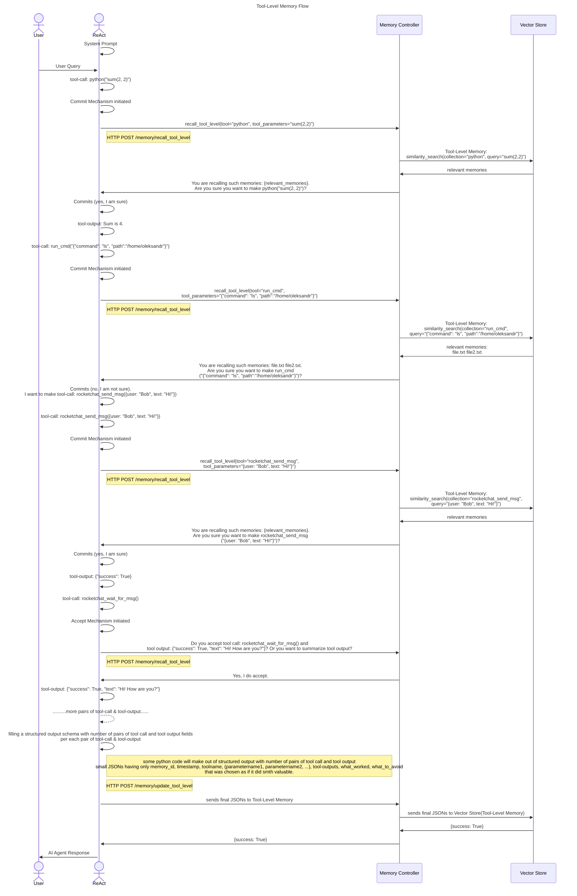
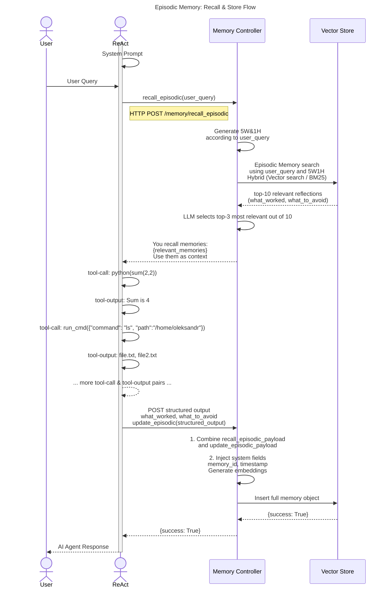

Still need to ask Codex having a context about overall Infrastructure to correct such paragraphs as: Context & Working Mode, Implementation Phases and Acceptance Checklist

# Context & Working Mode

**You are:** An AI coding agent extending the memory subsystem (for Brains microservice; a ReAct-based AI agent).

**Your goal:** Build a working prototype of implicit memory that adds Tool-Level Memory and Episodic Memory, together with the controller and harness logic needed to recall and update them automatically.

**Development stack:** Python-based Brains/ReAct harness, a Python HTTP microservice for Memory Controller, Weaviate as the vector store, and OpenAI models for embeddings and structured reflection.

**Existing environment:**
- ReAct/Brains already exists as the cognitive runtime
- Tool calls and tool outputs already exist within the agent trajectory
- Working memory / current conversation context already exists and is provided mainly by the agent runtime
- Memory should remain behind a dedicated Memory Controller abstraction layer

**Components in scope:**
- Memory Controller endpoints for tool-level and episodic recall/update flows
- Tool-Level Memory with one collection per tool and named vectors per relevant string parameter
- Episodic Memory with a dedicated collection and named vectors for semantic fields
- Brains/ReAct Python wrappers, Commit Mechanism, and Accept Mechanism integration

**Out of scope for this work:**
- Redesigning working memory
- Adding explicit memory tools directly callable by the agent
- General agent orchestration changes outside the memory integration points

**Communication pattern:**
- Brains/ReAct communicates with Memory Controller over HTTP
- Memory Controller reads from and writes to the vector store directly
- Tool-Level Memory is recalled before tool execution and updated after the task finishes
- Episodic Memory is recalled at task start and updated after reflection over the full trajectory

**Before writing substantial code:** If anything is ambiguous, ask up to 5 clarifying questions. Then produce a brief Architecture & Interface Spec confirming your interpretation.

# My Memory Conceptual Architecture

Memory subsystem is the information storage and retrieval part of our AI Agent. It consists of a vector store that contains several collections. It directly interacts with the Brains subsystem (ReAct). At the moment, our Memory subsystem is composed of 2 underlying memory components: tool-level, episodic memories.

---

# Table Of Contents

[**Memory Controller (code-only microservice)**](#memory-controller-code-only-microservice)
<br/>Memory Controller is a stateless microservice responsible for managing the lifecycle of agent memories. It exposes an HTTP API and serves as the abstraction layer between the cognitive system (ReAct/Brains) and persistent memory storage systems.

- [**Explicit & Implicit Memory**](#explicit-memory-conscious--implicit-memory-subconscious)
<br/>Division of the memory subsystem into two major categories: Explicit and Implicit. Explains how they differ, which memory types belong to each category, and discusses their trade-offs in latency, architectural separation, and update mechanisms.

- [**Working Memory**](#working-memory)
<br/>**This paragraph is provided for context only;** it does not contain any implementation ideas at the moment. 
Temporary, active workspace of the agent. Maintains current interaction state, conversation history, and short-term reasoning context.

- [**Tool-Level Memory**](#tool-level-memory)
<br/>Stores structured reflections about individual tool executions.

  - [**Sequence Diagram**](#sequence-diagram)  

  - [**/recall_tool_level**](#recall_tool_level)

  - [**/update_tool_level**](#update_tool_level)

  - [**/rewrite_tool_level**](#rewrite_tool_level)

- [**Episodic Memory**](#episodic-memory)
<br/>Stores past experiences and task executions. Includes structured reflections such as `what_worked`, `what_to_avoid`, summaries, and context tags.

  - [**Sequence Diagram**](#sequence-diagram-1)

  - [**/recall_episodic**](#recall_episodic)

  - [**/update_episodic**](#update_episodic)

[**Brains(ReAct) Python harness**](#brainsreact-python-harness)
<br/>Section describing the Python harness built around the implemented ReAct agent (Brains microservice) and the extensions to be added.

- [**Functions**](#functions)
  <br/>Functions are standard Python wrappers that guide the ReAct agent’s behavior (e.g., enforcing structured output, retrieve useful information from storage) and then call the corresponding Memory Controller endpoints. Cannot be invoked by the agent as needed.

  - [**recall_tool_level**](#recall_tool_level-1)

  - [**recall_episodic**](#recall_episodic-1)

  - [**update_tool_level**](#update_tool_level-1)

  - [**update_episodic**](#update_episodic-1)

- [**Mechanisms**](#mechanisms)
  <br/>Mechanisms paragraph describes extensions over ReAct to improve reliability, introducing control layers around tool usage

  - [**Commit Mechanism**](#commit-mechanism)
  <br/>Wrapper over tool execution that enforces validation and reflection before any state-modifying actions.

  - [**Accept Mechanism**](#accept-mechanism)
  <br/>Wrapper over read-access tools that validates and compresses outputs before storing them in working memory.

[**Initialization of DBs**](#initialization-of-dbs)
<br/>Initialization and configuration of all database systems (Vector and Graph Stores) that support different memory subsystems.

- [**Vector Store**](#vector-store)
<br/>Vector Store is a paragraph, which tells about vector store and its responsibilities for different memory subsystems (Tool-Level Memory, Episodic Memory).

  - [**Tool-level Memory config**](#tool-level-memory-config)
  <br/>Specific configuration of Vector Store collection(s) for Tool-level Memory   

  - [**Episodic Memory config**](#episodic-memory-config)
  <br/>Specific configuration of Vector Store collection(s) for Episodic Memory

[**Implementation Phases**](#12-implementation-phases)
<br/>Ordered delivery plan for bringing up the vector store schemas, Memory Controller endpoints, ReAct harness integration, memory rewriting, and end-to-end validation.

[**Acceptance Checklist**](#13-acceptance-checklist)
<br/>Final verification checklist covering vector-store schemas, memory endpoints, harness behavior, rewriting, output handling, and end-to-end integration.

# Memory Controller (code-only microservice)

Memory Controller is a stateless microservice responsible for managing the lifecycle of agent memories. It exposes an HTTP API and serves as the abstraction layer between the cognitive system (ReAct/Brains) and persistent memory storage systems.

## Explicit & Implicit Memory

As a starting point, we can categorize memory into Explicit and Implicit.
At this stage, all memory types — namely episodic, tool-level — will be Implicit.

Memory types categorized as Explicit expose a dedicated tool, which agent can call explicitly, but at the moment there is no such tools.

Memory types categorized as Implicit are running in the background for the agent(ReAct/Planner) by Memory subsystem. 

Comparing Implicit and Explicit memories, the Explicit approach has the downside of introducing some extra latency before any response is delivered. It also requires combining the memory logic with the agent logic. However, memories categorized as Implicit avoids those issues - there’s no added latency, and memory logic remains separate. But running “in the background” also has its own drawbacks: the memory is not updated immediately, and extra logic is needed determine when to kick off the background process.

## Working Memory

This paragraph is provided for context only; it does not contain any implementation ideas at the moment.

Working memory is what helps you keep track of information you are using right now and make sense of it as things change. For our Agents, it means remembering **the current conversation** and using it to respond properly in real time. 

At the moment, we can say that OpenAI provides a solution for working memory, but maintaining a consistently growing list of all user inputs, tool calls, tool outputs, and reasoning items—appended each time the agent receives inputs and produces outputs—looks like not the best solution.

Working memory acts as an active workspace that manages information between episodic experience retrieval and semantic knowledge access, while keeping track of the exact state of the current interaction.

For Example: 
HUMAN: Hello!

AI Agent: Hello!

HUMAN: What's my name?

AI Agent: I do not have access to that information

HUMAN: My name is Adam

AI Agent: It's nice to meet you, Adam!

HUMAN: What is my name?

AI Agent: You said your name is Adam

## Tool-level Memory

### Intro

As described earlier, our agent is built on a ReAct architecture.
Tool-Level Memory is a specialized memory layer that operates at the granularity of tool interactions. Specifically, it stores and retrieves structured memories for each (tool call, tool output) pair generated during a ReAct execution cycle.

The primary purpose of Tool-Level Memory is to: improve tool-call accuracy, reduce repeated mistakes, and enable self-reflection before performing potentially costly or state-modifying actions.

The overall framework operates in two main stages:
• Stage-1: Recall Stage. 
When the agent generates a new tool call, tool call goes to the Commit Mechanism. 
The system retrieves relevant past memories associated with the same toolname, tool's parameters and presents them to the agent for reflection and confirmation. Retrieval is performed using multi-vector similarity search across string tool parameters.

• Stage-2: Post-think and Update. 
After ReAct completes its task, a structured post-processing step is triggered. Code extracts all tool-call and tool-output pairs generated during execution. Proposes a structured output to the agent.
The agent fills struсtured output fields such as: `what worked`, `what to avoid` - for each tool-call and tool-output pair.

### Sequence Diagram



### /recall_tool_level

Memory Controller listens for the HTTP endpoint:
```code
POST /memory/recall_tool_level
```
When this endpoint is invoked, the Memory Controller understands that the agent is requesting relevant past memories from the Tool-Level Memory layer.
The request payload must contain:
```python
payload = {
  "collection": toolname, # the name of the tool; name of collection where to search
  "tool_parameters": params,   # raw structured parameters from tool call
  "top_k": top_k # how many elements to retrieve if there is more than k elements
}
```
Preconditions (More details can be found in `Initialization of DBs / Vector Store / Tool-level Memory config` paragpaph):
- The Vector Store(Tool-Level Memory) must already exist.
- Each tool must have its own collection.
- Each collection must contain named vectors corresponding to tool parameters.

Upon receiving the request, Memory Controller:
1. Parses the incoming tool parameters.
2. Generates separate embeddings for each parameter using the configured embedding model.
3. Selects the correct collection based on toolname.
4. Performs multi-vector similarity search for each parameter vector.
5. Aggregates similarity scores using a weighted scoring mechanism.
6. Retrieves the top_k most relevant memory entries.
7. Returns them as structured JSON.

Here is how I see searching(recalling) memory thoughts:
```python
# Search (Recall) should be like this
from openai import OpenAI

client = OpenAI()

# for example, toolname = "run_cmd"
toolname = "run_cmd"

def embed(text):
    response = client.embeddings.create(
        model="text-embedding-3-large", #3072 embedding dimensions should be
        input=text
    )
    return response.data[0].embedding

collection = client.collections.get(toolname)

query_shell = "bash"
query_command = "cat list_of_emails_by_worker.txt"
#query_timeout = embed(int(30)) -- because we save only string values

shell_results = collection.query.hybrid(
    query=query_shell,
    target_vector="shell_vector",
    alpha=0.7,
    limit=5
)
# could be embedded summarization of some tool params if param is bigger than PARAM_THRESHOLD
command_results = collection.query.hybrid(
    query=query_command,
    target_vector="command_vector",
    alpha=0.7,
    limit=5
)

scores = {}

def add_scores(results, weight):
    for obj in results.objects:
        id = obj.uuid
        sim = 1 - obj.metadata.distance
        
        if id not in scores:
            scores[id] = 0
            
        scores[id] += weight * sim

add_scores(shell_results, 0.4)
add_scores(command_results, 0.6)

best = sorted(scores.items(), key=lambda x: x[1], reverse=True)

best_id = best[0][0]

memory = collection.query.fetch_object_by_id(best_id)

print(memory.properties["what_worked"])
print(memory.properties["what_to_avoid"])
```

The weighted aggregation stage combines similarity scores from different parameter searches into a single ranking score for each memory entry.

Example scoring logic:
final_score = w1 * similarity(param1) + w2 * similarity(param2) + ...

This approach allows the system to retrieve memories that are semantically similar at the parameter level, rather than relying on a single combined embedding.

API Response Format

Memory Controller must return an HTTP JSON response:
```python
{
  "memories": [
    {
      "tool_call": "...",
      "tool_output": "...",
      "what_worked": "...",
      "what_to_avoid": "..."
    }
  ]
}
```

### /update_tool_level 
Memory Controller listens for the HTTP endpoint:
```code
POST /memory/update_tool_level
```
When this endpoint is invoked, the Memory Controller understands that the agent wants to persist memories generated from the recently completed ReAct execution cycle.
The request payload must look like this:
```python
payload = {
  "structured_output": [
    {
      "what_worked": "I have access to list_of_emails_by_worker.txt.",
      "what_to_avoid": "Reading list_of_emails_by_worker.txt with cat triggered a security alert. Received notification after this tool-call."
    },
    {
      "what_to_avoid": "Do not try to delete file without sudo access."
    }
  ],
  "tool_calls_and_outputs": [
    {
      "tool_call": "run_cmd(\"cat list_of_emails_by_worker.txt\")",
      "tool_output": "ivan.petrenko@gmail.com ..."
    },
    {
      "tool_call": "run_cmd(\"rm -rf list_of_emails_by_worker.txt\")",
      "tool_output": "You don't have enough permissions. You need sudo for this operation."
    }
  ]
}
```
Each element in structured_output must correspond by index to the same element in tool_calls_and_outputs.

Preconditions:
- The Vector Store(Tool-Level Memory) must already exist.
- Each tool must have its own collection.
- The collection schema must define separate vector fields for relevant tool parameters.
- More details can be found in `Initialization of DBs / Vector Store / Tool-level Memory config` paragpaph

Upon receiving the request, Memory Controller:
1. Transform Structured Output Into Final Dictionaries
Iterate through both arrays using index alignment.
For each pair:
- Inject tool_call and tool_output programmatically.
- If both what_worked and what_to_avoid are empty - skip this entry.
- Build a list of validated memory dictionaries.

2. Extract Tool Name and Parameters  
From each tool_call, extract:
```python
toolname, tool_parameters = extract_toolname_and_parameters(tool_call)
```

If len(tool_parameter) > PARAM_THRESHOLD:
- Summarize tool call using summarize_tool_parameter()
- Use summary as embedding input
- Store summary + file reference in corresponding field
Else:
- Store raw tool parameter in corresponding field
- Use raw tool parameter as embedding input

Tool output can be summarized by the Accept Mechanism if its size exceeds TOOL_OUTPUT_THRESHOLD and the agent decides to create a summary.

Then parse the parameters into a structured dictionary:
```python
{
    "memory_id": 1,
    "timestamp": "1.01.2026 10:36",
    "toolname": "run_cmd",
    "shell": "bash",
    "command": f"Summary of tool parameter: {command_summary}. Reference: Full tool parameter stored at /home/oleksandr/123tool_param_command.txt",
    "tool_output": f"Summary of tool output: {tool_output_summary}. 
    Reference: Full tool output stored at /home/oleksandr/123tool_output.txt",
    "what_worked": "I have access to list_of_emails_by_worker.txt.",
    "what_to_avoid": "Reading list_of_emails_by_worker.txt with cat triggered a security alert. Received notification after this tool-call."
}
```

```python
{
  "memory_id": 1,
  "timestamp": "1.01.2026 10:36",
  "toolname": "run_cmd",
  "shell": "bash",
  "command": f"\"cat list_of_emails_by_worker.txt\"",
  "tool_output": "ivan.petrenko@gmail.com anna.kovalchuk@yahoo.com oleg.shevchenko@ukr.net maria.bondar@outlook.com dmytro.tkachenko@gmail.com iryna.melnyk@yahoo.com vlad.kozlov@ukr.net sofia.hrytsenko@gmail.com maksym.danilenko@outlook.com kateryna.polishchuk@yahoo.com",
  "what_worked": "I have access to list_of_emails_by_worker.txt.",
  "what_to_avoid": "Reading list_of_emails_by_worker.txt with cat triggered a security alert. Received notification after this tool-call." 
}
```

Each parameter is stored as its own property in the vector store schema.
Unlike the previous single-vector architecture, no combined tool signature embedding is created.
Instead: each parameter, which type is string, becomes a separate embedding source; each such parameter is mapped to its own named vector.

Example embedding generation:
```python
shell_embedding = embedding_model.encode(shell)
command_embedding = embedding_model.encode(command)
```
These embeddings are automatically indexed by the vector database according to the schema.


3. Insert Into Correct Collection
Collection must match the tool name:
```python
collection = client.collections.get(toolname)
collection.data.insert(
    {
        "memory_id": 1,
        "timestamp": "1.01.2026 10:36",
        "tool_name": toolname,
        "shell": shell,
        "command": command,
        "tool_call": tool_call,
        "tool_output": tool_output,
        "what_worked": what_worked,
        "what_to_avoid": what_to_avoid
    }
)
```
Each tool has its own collection.
The vector database automatically generates named vectors for each parameter field based on the collection schema.

API Response Format
Memory Controller must return an HTTP JSON response:
Success:
```python
{"success": True}
```
Failure:
```python
{
  "success": False,
  "error": "Detailed error message from memory transformation or vector store."
}
```

### /rewrite_tool_level

After each Post-Think stage, the system performs a Tool-Level Memory Rewriting process. 
The goal of this process is to improve memory quality by removing redundancy, consolidating similar observations, and resolving contradictions that may arise as the agent gains more experience.

The system first identifies all Tool-Level Memory collections that were updated during the Post-Think stage.
For each affected collection, an LLM-based rewriting pipeline is executed.

The rewriting pipeline consists of two sequential stages:
- Memory Merging
- Contradiction Resolution

Both stages are implemented using LLM reasoning and operate on batches of recently updated memories.

**Execution Model**

The rewriting process is currently implemented as a two-step LLM pipeline:
1. Memory Merging LLM pass
2. Contradiction Resolution LLM pass

This separation improves reasoning quality because:
- the first pass focuses purely on deduplication
- the second pass focuses on semantic conflict analysis

I see implementation like this:
```python
from openai import OpenAI
from dotenv import load_dotenv

load_dotenv()
client = OpenAI()

set_of_memories = [
{
"memory_id": 1,
"timestamp": "06.03.2026 14:10",
"react_id": 1,
"tool_call": "run_cmd(path: /"/home/oleksandr/", cmd: /"cat config.yaml/")",
"tool_output": "Permission denied",
"what_to_avoid": "Trying to read config.yaml without sudo access.",
"what_worked": "—"
},
{
"memory_id": 2,
"timestamp": "06.03.2026 15:00"
"react_id": 1,
"tool_call": "run_cmd(path: /"/home/oleksandr/", cmd: /"ls/")"
"tool_output": "input.txt, intermediate.txt"
"what_to_avoid": "Checking result files while the processing script is still running."
"what_worked": "—"
},
{
"memory_id": 3,
"timestamp": "06.03.2026 15:05"
"react_id": 1,
"tool_call": "run_cmd(path: /"/home/oleksandr/", cmd: /"ls/")",
"tool_output": "input.txt, intermediate.txt",
"what_to_avoid": "Attempting to verify final results before the program has finished execution.",
"what_worked": "—"
}
{
"memory_id": 4,
"timestamp": "06.03.2026 15:09",
"react_id": 1,
"tool_call": run_cmd(path: "/home/oleksandr", cmd: "ls")
"tool_output": "input.txt, intermediate.txt, output.txt, config.yaml"
"what_to_avoid": "—",
"what_worked": "Checking the directory after the background process finished reveals the generated output file."
}, 
{
"memory_id": 5,
"timestamp": "06.03.2026 15:11",
"react_id": 1,
"tool_call": "run_cmd(path: /"/home/oleksandr/", cmd: /"cat config.yaml/")"
"tool_output": "database_url: postgres://localhost...",
"what_to_avoid": "—",
"what_worked": "Reading config.yaml directly using cat successfully returned configuration data after execution of background script."
}
]

prompt_merge = f"""
You are given a group of memories describing tool usage events.

Your task is to merge memories that describe the SAME situation or observation.

A memory has the following structure:
- memory_id
- timestamp
- tool_call
- tool_output
- what_to_avoid
- what_worked

MERGING RULES

1. Merge memories if they describe the same tool call and the same situation
   but are written slightly differently.

2. When merging:
   - Keep the memory with the MOST RECENT timestamp as the base memory.
   - Transfer useful information from older memories into the base memory.

3. If multiple memories contain similar "what_to_avoid" advice,
   merge them into a single clearer sentence.

4. If multiple memories contain similar "what_worked" advice,
   merge them into one concise explanation.

5. Do NOT merge memories if they clearly describe different situations,
   different tool calls, or different environments.

6. The final merged memory must keep the structure:
memory_id
timestamp
tool_call
tool_output
what_to_avoid
what_worked

7. If several memories describe the same event progression,
   prefer the most informative tool_output (usually the latest one).

Example

Input memories:

memory_id: 2
tool_call: run_cmd(path="/home/oleksandr", cmd="ls")
tool_output: "input.txt, intermediate.txt"
what_to_avoid: Checking result files while the processing script is still running.

memory_id: 3
tool_call: run_cmd(path="/home/oleksandr", cmd="ls")
tool_output: "input.txt, intermediate.txt"
what_to_avoid: Attempting to verify final results before the program has finished execution.

memory_id: 4
tool_call: run_cmd(path="/home/oleksandr", cmd="ls")
tool_output: "input.txt, intermediate.txt, output.txt, config.yaml"
what_worked: Checking the directory after the background process finished reveals the generated output file.

Output:

memory_id: 4
tool_call: run_cmd(path="/home/oleksandr", cmd="ls")
tool_output: "input.txt, intermediate.txt, output.txt, config.yaml"
what_to_avoid: Checking result files while the processing script is still running.
what_worked: Checking the directory after the background process finished reveals the generated output file.

Now merge the following memories:

Input:
{set_of_memories}
"""

# ---- First LLM call ----
response1 = client.responses.create(
    model="gpt-5-nano",
    input=prompt_merge
)

set_of_memories = response1.output_text
print("\nFirst response:\n", set_of_memories)

prompt_resolve_conflicts = f"""
You are given several memories describing tool executions and observations.

Some memories may contradict each other because:
- the environment changed over time
- earlier observations were incomplete
- conditions differed between executions

Your task is to detect and resolve contradictions between memories.

IMPORTANT:
You are NOT required to produce only one memory.
You may return multiple memories.

GENERAL RULE

Only merge memories if they describe the SAME tool_call and contain
contradictory observations about the result or conclusions.

If memories describe different situations or different tool calls,
keep them as separate memories.

Each memory has the following structure:

memory_id
timestamp
tool_call
tool_output
what_to_avoid
what_worked

CONFLICT RESOLUTION RULES

1. Detect groups of memories that refer to the SAME tool_call.
2. If there is NO contradiction between them, keep them unchanged.
3. If there IS a contradiction:
   a) Prefer the memory with the MOST RECENT timestamp
      as the base memory, because it reflects the most
      up-to-date state of the environment.
   b) Earlier memories should NOT be discarded if they contain
      useful lessons.
   c) Convert earlier conclusions into contextual advice inside:
      - "what_to_avoid"
      - "what_worked"
4. If an earlier failure later becomes a success,
   reinterpret the earlier failure as a contextual limitation.
Example:
- failure before a process finished
- success after the process finished

5. When merging advice:
   - move incorrect or outdated conclusions into a contextualized warning inside "what_to_avoid"
   - keep successful strategies in "what_worked"

6. Always preserve the memory structure:

memory_id
timestamp
tool_call
tool_output
what_to_avoid
what_worked

7. The output may contain:
   - the same number of memories
   - fewer memories if some were merged

8. Do NOT remove useful information.
   Only resolve contradictions.

Example

Input memories:

memory_id: 1
timestamp: 06.03.2026 14:10
tool_call: run_cmd(path="/home/oleksandr", cmd="cat config.yaml")
tool_output: "Permission denied"
what_to_avoid: Trying to read config.yaml without sudo access.

memory_id: 5
timestamp: 06.03.2026 15:11
tool_call: run_cmd(path="/home/oleksandr", cmd="cat config.yaml")
tool_output: "database_url: postgres://localhost..."
what_worked: Reading config.yaml directly using cat successfully returned configuration data after execution of background script.

Output:

memory_id: 5
timestamp: 06.03.2026 15:11
tool_call: run_cmd(path="/home/oleksandr", cmd="cat config.yaml")
tool_output: "database_url: postgres://localhost..."
what_to_avoid: Trying to read config.yaml before or during execution of the background script.
what_worked: Reading config.yaml directly using cat successfully returned configuration data after execution of the background script.

Now resolve contradictions in the following memories:

Input:
{set_of_memories}
"""

# ---- Second LLM call ----
response2 = client.responses.create(
    model="gpt-5-nano",
    input=prompt_resolve_conflicts
)

result2 = response2.output_text
print("\nSecond response:\n", result2)
```

**Scalability Considerations**

The described rewriting approach assumes that the number of memories processed in a single batch is moderate (under 50).

## Episodic Memory

### Intro

Episodic memory is a historical collection of prior experiences, or episodes. It includes what happened, how it happened, and the lessons or insights learned from those experiences, even if they were never clearly stated.

### Sequence Diagram


### /recall_episodic

Memory Controller listens for the HTTP endpoint:
```code
POST /memory/recall_episodic
```
When this endpoint is invoked, the Memory Controller understands that the agent wants to retrieve relevant memories from an episodic memory thought generated after the completion of a task.

The request payload must look like this:
```python
payload = {
    "user_query": "Add a donation feature to an existing static website for a frontline animal shelter to enable fundraising and communicate the urgency of support.",
    "who": "Visitors and potential donors of the animal shelter website",
    "what": "Integration of a donation feature into an existing static website",
    "when": "During a website update aimed at improving fundraising capability",
    "where": "On the existing static website of a frontline animal shelter",
    "why": "To enable fundraising and clearly communicate the urgency of supporting the shelter",
    "how": "By embedding a prominent call-to-action that redirects users to an external donation service without modifying backend logic"
}
```

During recall, the system embeds the query context and performs independent vector searches for each semantic field. The results are merged using weighted similarity scoring.

Example retrieval procedure:
```python
# Search (Recall) should be like this
from openai import OpenAI

client = OpenAI()

collection = client.collections.get("episodic_memory")

user_query_memories = collection.query.hybrid(
    query=payload["user_query"],
    alpha=0.7,
    limit=5,
    target_vector="user_query_vector",
    return_metadata=["score"]
)

who_memories = collection.query.hybrid(
    query=payload["who"],
    alpha=0.7,
    limit=5,
    target_vector="who_vector",
    return_metadata=["score"]
)

what_memories = collection.query.hybrid(
    query=payload["what"],
    alpha=0.7,
    limit=5,
    target_vector="what_vector",
    return_metadata=["score"]
)

when_memories = collection.query.hybrid(
    query=payload["when"],
    alpha=0.7,
    limit=5,
    target_vector="when_vector",
    return_metadata=["score"]
)

where_memories = collection.query.hybrid(
    query=payload["where"],
    alpha=0.7,
    limit=5,
    target_vector="where_vector",
    return_metadata=["score"]
)

why_memories = collection.query.hybrid(
    query=payload["why"],
    alpha=0.7,
    limit=5,
    target_vector="why_vector",
    return_metadata=["score"]
)

how_memories = collection.query.hybrid(
    query=payload["how"],
    alpha=0.7,
    limit=5,
    target_vector="how_vector",
    return_metadata=["score"]
)

scores = {}

def add_scores(results, weight):
    for obj in results.objects:
        id = obj.uuid
        sim = 1 - obj.metadata.distance
        
        if id not in scores:
            scores[id] = 0
            
        scores[id] += weight * sim

add_scores(user_query_memories, 0.25)
add_scores(who_memories, 0.125)
add_scores(what_memories, 0.125)
add_scores(when_memories, 0.125)
add_scores(where_memories, 0.125)
add_scores(why_memories, 0.125)
add_scores(how_memories, 0.125)

top_k = 10
best = sorted(scores.items(), key=lambda x: x[1], reverse=True)[:top_k]

top_k_elements = ""

for memory_id, score in best:
  memory = collection.query.fetch_object_by_id(memory_id)

  top_k_elements += f"memory_id: {memory.properties['memory_id']}\n"
  top_k_elements += f"timestamp: {memory.properties['timestamp']}\n"
  top_k_elements += f"user_query: {memory.properties['user_query']}\n"
  top_k_elements += f"who: {memory.properties['who']}\n"
  top_k_elements += f"what: {memory.properties['what']}\n"
  top_k_elements += f"when: {memory.properties['when']}\n"
  top_k_elements += f"where: {memory.properties['where']}\n"
  top_k_elements += f"why: {memory.properties['why']}\n"
  top_k_elements += f"how: {memory.properties['how']}\n"
  top_k_elements += f"what_worked: {memory.properties['what_worked']}\n"
  top_k_elements += f"what_to_avoid: {memory.properties['what_to_avoid']}\n\n"
```

The system(Memory Controller) returns the 10 memories with the highest combined similarity score.

After that LLM (gpt-5.5) with structured output is asked to took out 3 most relevant memories out of 10 memories with the highest combined similarity score.

Example of how I see implementation and usage:
```python
from pydantic import BaseModel, Field

class MemorySelection(BaseModel):
    explanation: str = Field(
        description="Explain why these 3 memories were selected as the most relevant."
    )
    top_1_memory_id: int = Field(description="ID of the most relevant memory")
    top_2_memory_id: int = Field(description="ID of the second most relevant memory")
    top_3_memory_id: int = Field(description="ID of the third most relevant memory")

def select_top_memories(top_k_elements: str, user_query: str):
    prompt = f"""
Here are 10 memories with the highest combined similarity score:
{top_k_elements}

Your task is to select the 3 most relevant memories according to the user query.

Each memory has:
- memory_id
- timestamp
- user_query
- who
- what
- when
- where
- why
- how
- what_worked
- what_to_avoid

IMPORTANT:
- Only choose from the provided IDs
- Do NOT invent new IDs
- Rank them by relevance (1 = best)

User query:
{user_query}

Return the result in structured format.
"""

    response = client.responses.parse(
        model="gpt-5.5",
        input=prompt,
        response_format=MemorySelection
    )

    return response.output_parsed


result = select_top_memories(
    top_k_elements="[{memory_id:1, timestamp:'...', user_query:'...', who: '...', what: '...', when: '...', where: '...', why: '...', what_worked: '...', what_to_avoid: '...'}, {memory_id:2, timestamp:'...'}, ...]",
    user_query="How to optimize Vector DB? Identify top-3 insights/solutions and then send it to the Ihor"
)

print(result)
```

Then Memory Controller sends top-3 memories to ReAct. Then these top-3 memories are inserted into ReAct's user prompt.

Also, you need to save payload for update_episodic endpoint.

### /update_episodic 

Memory Controller listens for the HTTP endpoint:
```code
POST /memory/update_episodic
```
When this endpoint is invoked, the Memory Controller understands that the agent wants to persist an episodic memory thought generated after the completion of a task.

Preconditions:
- The Episodic Memory Vector Store collection must already exist.
- The schema must define seven Named Vectors corresponding to the following semantic fields: user_query, who, what, when, where, why, how.
More details can be found in `Initialization of DBs / Vector Store / Episodic Memory config` paragraph.

Upon receiving the request, Memory Controller:
1. Combines payload from `recall_episodic` endpoint and payload from `update_episodic` endpoint

The request payload must look like this example:
```python
payload = {
    "what_worked": "Embedding a prominent donation call-to-action inside the existing page layout allowed the fundraising feature to be added without restructuring the site.",
    "what_to_avoid": "Implementing custom payment logic or backend processing when an external donation link is sufficient for a static charity website."
}
```

Before invoking an `update_episodic` endpoint was invoked `recall_episodic` endpoint, which needed to save a `payload` for update_episodic endpoint. 
Let's call it recall_episodic_payload. It has to look like this exaample:
```python
recall_episodic_payload = {
    "user_query": "Add a donation feature to an existing static website for a frontline animal shelter to enable fundraising and communicate the urgency of support.",
    "who": "Visitors and potential donors of the animal shelter website",
    "what": "Integration of a donation feature into an existing static website",
    "when": "During a website update aimed at improving fundraising capability",
    "where": "On the existing static website of a frontline animal shelter",
    "why": "To enable fundraising and clearly communicate the urgency of supporting the shelter",
    "how": "By embedding a prominent call-to-action that redirects users to an external donation service without modifying backend logic",
}
``` 

So final combined dict has to look like this.
```python
payload = {
    "user_query": "Add a donation feature to an existing static website for a frontline animal shelter to enable fundraising and communicate the urgency of support.",
    "who": "Visitors and potential donors of the animal shelter website",
    "what": "Integration of a donation feature into an existing static website",
    "when": "During a website update aimed at improving fundraising capability",
    "where": "On the existing static website of a frontline animal shelter",
    "why": "To enable fundraising and clearly communicate the urgency of supporting the shelter",
    "how": "By embedding a prominent call-to-action that redirects users to an external donation service without modifying backend logic",
    "what_worked": "Embedding a prominent donation call-to-action inside the existing page layout allowed the fundraising feature to be added without restructuring the site.",
    "what_to_avoid": "Implementing custom payment logic or backend processing when an external donation link is sufficient for a static charity website."
}
```

2. Inject System Fields
Before storing the memory, the system enriches it with internal metadata fields: memory_id, timestamp.
memory_id is generated automatically by the Memory Controller.  
timestamp records the exact time when the memory is stored.

Example:
```python
{
  "memory_id": 5,
  "timestamp": "1.01.2026 10:36",
  "user_query": "Add a donation feature to an existing static website for a frontline animal shelter to enable fundraising and communicate the urgency of support.",
  "who": "Visitors and potential donors of the animal shelter website",
  "what": "Integration of a donation feature into an existing static website",
  "when": "During a website update aimed at improving fundraising capability",
  "where": "On the existing static website of a frontline animal shelter",
  "why": "To enable fundraising and clearly communicate the urgency of supporting the shelter",
  "how": "By embedding a prominent call-to-action that redirects users to an external donation service without modifying backend logic",
  "what_worked": "Embedding a prominent donation call-to-action inside the existing page layout allowed the fundraising feature to be added without restructuring the site.",
  "what_to_avoid": "Implementing custom payment logic or backend processing when an external donation link is sufficient for a static charity website."
}
```

3. Insert Into Episodic Memory Collection
Each of the seven semantic fields is embedded, using text-embedding-3-large(3072 embedding dimensions). Seven semantic fields are: "user_query", "who", "what", "when", "where", "why", "how".
These embeddings are automatically indexed by the vector database according to the Named Vector schema.
```python
collection = client.collections.get("episodic_memory")
collection.data.insert(
    {
        "memory_id": memory_id,
        "timestamp": timestamp,
        "user_query": payload["user_query"],
        "who": payload["who"],
        "what": payload["what"],
        "when": payload["when"],
        "where": payload["where"],
        "why": payload["why"],
        "how": payload["how"],
        "what_worked": payload["what_worked"],
        "what_to_avoid": payload["what_to_avoid"]
    }
)
```
The vector database automatically generates the seven Named Vectors:
user_query_vector, who_vector, what_vector, when_vector, where_vector, why_vector, how_vector.
Each episodic memory entry therefore contains seven independent vector representations corresponding to its semantic fields.

API Response Format

Memory Controller must return an HTTP JSON response.

Success:
```python
{
  "success": True
}
```

Failure:
```python
{
  "success": False,
  "error": "Detailed error message from episodic memory validation or vector store insertion."
}
```

# Brains(ReAct) Python harness

## Functions

### recall_tool_level

When the ReAct worker generates a tool call, that tool call is passed to the Commit Mechanism. The Commit Mechanism invokes the `recall_tool_level` function, which calls Memory Controller over `/memory/recall_tool_level`. `recall_tool_level` returns a list of relevant memories retrieved from the Vector Store(Tool-Level Memory). After all, relevant memories will be inserted in Commit Mechanism message. Those retrieved memories are then inserted into the Commit Mechanism message, allowing the agent to reflect on past tool usage before executing the new tool call.

Unlike the previous architecture that relied on a **single combined embedding**, the current system performs **multi-vector retrieval across individual tool parameters**.

Each parameter is embedded independently and searched against its corresponding vector index in the Vector Store(Tool-Level Memory). Similarity scores from multiple parameter searches are then aggregated using a weighted scoring function.

Here is how approximately I see implementation of `recall_tool_level()` ,`summarize_tool_parameter()` and `extract_toolname_and_parameters()`:
```python
import os
from dotenv import load_dotenv
from openai import OpenAI
import requests

load_dotenv()

client = OpenAI(
    api_key=os.getenv("OPENAI_API_KEY")
)

def summarize_tool_parameter(toolname: str, parameter_name: str, parameter_value: str) -> str:
  """Generate a concise one-sentence summary describing the intent of a tool parameter.
  The summary explains what the parameter value represents or what action it intends to perform, without mentioning the tool name or parameter name.
  Args:
        tool_name (str):
            Name of the tool being invoked.

        parameter_name (str):
            Name of the parameter passed to the tool.

        parameter_value (str):
            Value of the parameter that should be summarized.

    Returns:
        str:
            A single-sentence summary describing the intent of the parameter value.
  """
  prompt = f"""
You must produce a precise, single-sentence description of the action implied by a tool parameter value.

Context:
Tool name: {tool_name}
Parameter name: {parameter_name}
Parameter value:
{parameter_value}

Rules:
- Output EXACTLY one sentence.
- Describe what the parameter value is intended to do.
- Do NOT mention the tool name or parameter name.
- Be concrete and explicit about the action.
- Describe only the intended operation, not the result.
- Avoid vague phrases such as "processed data", "handled file", or "performed operation".

Example (Good):
Tool name: run_cmd
Parameter name: command
Parameter value: cat list_of_emails_by_worker.txt
Output:
Read the file "list_of_emails_by_worker.txt" using the cat command.

Example (Bad):
Read emails using run_cmd.
"""
    response = client.responses.create(
      model="gpt-5-nano",
      input=prompt
    )
    return response.output[0].content[0].text.strip()

def extract_toolname_and_parameters(tool_call: str) -> tuple:
    start = tool_call.find("(")
    end = tool_call.rfind(")")

    if start == -1 or end == -1 or start > end:
        return ""  # or give error

    return (tool_call[:start], tool_call[start + 1:end])

# Recall Tool-Level Memory Mechanism
MEMORY_CONTROLLER_URL = os.getenv("MEMORY_CONTROLLER_URL")
def recall_tool_level(
    toolname: str,
    tool_parameters: str,
    top_k: int = 5
) -> list:
  """Recall relevant memories from Tool-level memory for a specific tool using multi-vector parameter search.

  Each parameter is embedded separately inside the Memory Controller and searched against its corresponding named vector index. The Memory Controller aggregates similarity scores across parameters and returns the most relevant memories.

  This function is a wrapper over the Memory Controller API (e.g., POST /memory/recall_tool_level). It retrieves previously stored tool-call experiences related to the given tool.

  Purpose:
    The goal of recall is to provide the agent with past 
    experiences (successes, failures, security alerts, rate limits, etc.) related to similar tool calls, so that the agent can adapt 
    its reasoning before continuing execution.

  Args:
    toolname (str):
        The name of the tool whose memory collection should be searched.

    tool_parameters (str):
        It should be a tool parameters from tool call.

    top-k (int, optional):
        How many elements to retrieve if there is more than k elements. (default = 5).

    Returns:
        List:
            API response containing a list_of_relevant_memories.
    Example of tool usage:
      recall_tool_level(toolname="run_cmd", tool_parameters="cat list_of_emails_by_worker.txt")
"""
    list_of_param_names, list_params = extract_params(tool_parameters)
    ind = 0
    for param_name in list_of_param_names:
      ind += 1
      param = list_params[ind]
      if len(tool_parameter) > PARAM_THRESHOLD:
        query = summarize_tool_parameter(param_name, param)
      else:
        query = tool_parameter

    url = f"{MEMORY_CONTROLLER_URL}/memory/recall_tool_level"

    payload = {
        "collection": toolname,
        "tool_parameters": tool_parameters,
        "top_k": top_k
    }

    try:
        response = requests.post(url, json=payload)
        response.raise_for_status()

        data = response.json()

        # Expected format:
        # {
        #     "memories": [...]
        # }

        return data.get("memories", [])

    except requests.exceptions.RequestException as e:
        print(f"[Tool-Level Recall Error] {e}")
        return []
```

Example usage:
```python
tool_call = 'run_cmd({"shell":"bash", "command":"cat list_of_emails_by_worker.txt"})'

toolname, params = extract_toolname_and_parameters(tool_call)

memories = recall_tool_level(
    toolname=toolname,
    tool_parameters=params
)
```

### recall_episodic

When a new ReAct worker is invoked by the PlanExecutor, the `recall_episodic` function is called with `query` parameter equal to user query, which calls Memory Controller over `/memory/recall_episodic`. `recall_episodic` returns a list of relevant memories retrieved from Episodic Memory (the Vector Store(Episodic Memory collection) + LLM selection). After all, relevant memories will be inserted in User Prompt of this ReAct worker.  

Fields user_query, what, who, when, where, why, how is embedded independently and searched against its corresponding vector index in the Vector Store(Episodic Memory). Similarity scores from multiple searches are then aggregated using a weighted scoring function.

Here is how approximately I see implementation of `recall_episodic()`:
```python
import os
from dotenv import load_dotenv
from openai import OpenAI
import requests

load_dotenv()

client = OpenAI(
    api_key=os.getenv("OPENAI_API_KEY")
)

from pydantic import BaseModel, Field

class EpisodicContext(BaseModel):
    who: str = Field(..., description="Actors or stakeholders involved")
    what: str = Field(..., description="Exact task or action performed")
    when: str = Field(..., description="Timing, condition, or trigger")
    where: str = Field(..., description="Platform, system, or environment")
    why: str = Field(..., description="Goal or motivation")
    how: str = Field(..., description="Method or implementation approach")

# Recall Tool-Level Memory Mechanism
MEMORY_CONTROLLER_URL = os.getenv("MEMORY_CONTROLLER_URL")
def recall_episodic(
    query: str
) -> list:
  """Recall relevant memories from Episodic memory according to query using multi-vector search across fields user_query, what, who, when, where, why, how.

  Fields user_query, what, who, when, where, why, how is embedded separately inside the Memory Controller and searched against its corresponding named vector index. The Memory Controller aggregates similarity scores across Fields user_query, what, who, when, where, why, how and returns the most relevant memories.

  This function is a wrapper over the Memory Controller API (e.g., POST /memory/recall_episodic).

  Purpose:
    The goal of recall is to provide the agent with past 
    experiences (reflections, successes, failures, security alerts, rate limits, etc.), so that the agent can adapt.

  Args:
    query (str):
        User query or input provided to the ReAct agent

    Returns:
        List:
            API response containing a list_of_relevant_memories.
    Example of tool usage:
      recall_episodic(user_query="How to optimize Vector DB? Identify top-3 insights/solutions and then send it to the Ihor")
"""
    structured_5w1h_system_prompt = f"""
    You are an AI system that converts a user query into a structured episodic memory representation.

    Your goal is to extract maximum informative (highly informative) context using the 5W1H framework.

    STRICT RULES:
    - Output MUST be valid JSON only (no explanations, no extra text)
    - Use ONLY English language (no Ukrainian or any other language)
    - Be concise but maximum informative (high signal, no fluff)
    - Do NOT mention "AI agent", "system", or refer to yourself
    - Write as a neutral factual memory (not narration)
    - Avoid generic phrases like "someone", "something", "various"
    - Be specific whenever possible

    FIELDS REQUIREMENTS:
    - "who": concrete actors, users, or stakeholders involved
    - "what": exact action/task performed
    - "when": the context, situation, or triggering condition (do not include date/time, as timestamps are stored separately in the format DD.MM.YYYY HH:MM)
    - "where": environment, platform, or context (e.g., static website, backend system)
    - "why": underlying goal, motivation, or problem being solved
    - "how": concrete method, approach, or implementation strategy

    INPUT:
    user_query: {query}

    OUTPUT FORMAT:
    {
      "who": "...",
      "what": "...",
      "when": "...",
      "where": "...",
      "why": "...",
      "how": "..."
    }
    """
    response = client.responses.parse(
        model="gpt-5.5",
        input=[
            {
                "role": "system",
                "content": structured_5w1h_system_prompt
            },
            {
                "role": "user",
                "content": f"Your goal is to extract maximum informative context using the 5W1H framework according to this user_query: {user_query}"
            }
        ],
        response_format=EpisodicContext
    )

    context_dict = model_dump(response.output_parsed)

    url = f"{MEMORY_CONTROLLER_URL}/memory/recall_episodic"

    payload = {
        "user_query": query,
        "who": context_dict["who"],
        "what": context_dict["what"],
        "when": context_dict["when"],
        "where": context_dict["where"],
        "why": context_dict["why"],
        "how": context_dict["how"]
    }

    try:
        response = requests.post(url, json=payload)
        response.raise_for_status()

        data = response.json()

        # Expected format:
        # {
        #     "memories": [...]
        # }

        return data.get("memories", [])

    except requests.exceptions.RequestException as e:
        print(f"[Episodic Memory Recall Error] {e}")
        return []
```

Example usage:
```python
user_query = "How to optimize Vector DB? Identify top-3 insights/solutions and then send it to the Ihor"

memories = recall_episodic(
    query=user_query
)
```
Memories needs to be added to the User Prompt. It can be appended at the end of the User Prompt or placed before the last section (for example, before the Output Format section), depending on where it fits best.
```python
relevant_episodic_memories = f"""You recall similar past interactions with the user. They are sorted by decreasing relevance:
First:
    What has worked well: {memories[0]["what_worked"]}
    What to avoid: {memories[0]["what_to_avoid"]}
Second:
    What has worked well: {memories[1]["what_worked"]}
    What to avoid: {memories[1]["what_to_avoid"]}
Third:
    What has worked well: {memories[2]["what_worked"]}
    What to avoid: {memories[2]["what_to_avoid"]}
Use these memories as context for your response to the user."""
```

### update_tool_level

After ReAct completes its task, the system automatically triggers a **post-execution reflection stage**. During this stage, the system extracts all `(tool-call, tool-output)` pairs produced during execution. A dynamic structured output schema is then generated using a function similar to `create_post_think_model`. 
The agent must analyze each tool interaction and optionally fill the following fields:
- `what_worked`
- `what_to_avoid`

Each filled field represents a **valuable insight** that should be stored in Tool-Level Memory. Only a **small subset of interactions** typically produces useful memories.

Example of function create_post_think_model:
```python
class PairToolCallOutput(BaseModel):
    what_worked: Optional[str] = Field(
        None,
        description="If there is something useful in this pair of tool call and tool output, then write it down. For example, include specific examples of successful tool usage(not basic one), well-chosen parameters, and the situations where the tool was used appropriately.",
    )
    what_to_avoid: Optional[str] = Field(
        None,
        description="If there is something useful in this pair of tool call and tool output that will be good to avoid, then write it down. For example, include examples of poor parameter choices, incorrect usage patterns, or situations where the tool should not have been used.",
    )

def create_post_think_model(
    list_of_pairs: List[Tuple[str, str]]
) -> Type[BaseModel]:
    """Dynamically create a Pydantic model for structured output based on the number of tool-call and tool-output pairs agent performed in the task.

    Args:
        list_of_pairs (List[Tuple[str, str]]): A list of tuples where each tuple contains the tool-call and tool-output.
    Returns:
        Type[BaseModel]: A Pydantic model class for structured output.
        Fields:
        - init_analysis: InitAnalysis
        - pair1, pair2, ..., pairN: PairToolCallOutput
    """

    # Add steps and grades
    for i, tool_call, tool_output in enumerate(list_of_pairs):
        fields[f"pair_{i+1}"] = (
            PairToolCallOutput, 
            Field(
                ..., 
                description=(
                    f"Analyze the following tool interaction.\n\n"
                    f"Tool Call:\n{tool_call}\n\n"
                    f"Tool Output:\n{tool_output}\n\n"
                    f"Provide analysis of this interaction."
                ),
            )
        )
    return create_model("ToolLevelAnalysis", **fields)
```

The prompt you need to provide to the Agent:

```python
user_prompt_to_agent = """
You are analyzing your own trajectory of solving a task in order to create memories that will help guide future interactions.
Your task is to extract key elements that would be most helpful when encountering similar situations in the future.

Review the trajectory and create a memory reflection following these rules:

1. If you do not have enough information for a field, the tool call-tool output pair is not relevant, contains nothing useful, or only includes generic advice, leave that field empty.
2. Do not include generic advice — extract only insights grounded in this specific tool-call and tool-output pair.
3. Be extremely concise - each string should be one clear, actionable sentence
4. Focus only on information that would be useful for handling similar future situations

Only a small number of insights is expected per trajectory (approximately 0–10% of the total number of tool call–tool output pairs).

It is completely normal for most fields to be empty.
It is also normal to fill only one field (e.g., what_worked or what_to_avoid) when applicable.

**Output Format:**
You must answer using the Structured Output format required by the system. In that format:
what_worked:
Describe a useful tool usage pattern observed in this interaction.

what_to_avoid:
Describe a tool usage pattern that should be avoided.

Examples:
Good "what_worked":
- "Using curl with the -L flag correctly followed redirects and retrieved the final page content."
- "Specifying the exact file path reduced unnecessary directory exploration."
- ""

Bad "what_worked":
- "It is better to use it like this."
- "The tool worked well."

Good "what_to_avoid":
- "Reading secret_passwords.md with cat triggered a security alert."
- "Calling the search tool without a query parameter caused an execution error."
- ""

Bad "what_to_avoid":
- "Do not read that file."
- "Avoid mistakes."

What worked examples:
- "Providing a precise query string improved the relevance of search results."
- "Using structured arguments instead of free text reduced parsing errors."

What to avoid examples:
- "Invoking the tool from Python code too frequently resulted in rate limit errors."
- "Using broad queries returned too many irrelevant results."
"""
``` 

Then, a list of tool calls and their outputs, along with a list of what_worked and what_to_avoid, is sent to the /memory/update_tool_level endpoint. The two lists must correspond to each other by index.

I see payload like this:
```python
payload = {
  "structured_output": [
    {
      "what_worked": "I have access to list_of_emails_by_worker.txt.",
      "what_to_avoid": "Reading list_of_emails_by_worker.txt with cat triggered a security alert. Received notification after this tool-call."
    },
    {
      "what_to_avoid": "Do not try to delete file without sudo access."
    }
  ],
  "tool_calls_and_outputs": [
    {
      "tool_call": "run_cmd(\"cat list_of_emails_by_worker.txt\")",
      "tool_output": "ivan.petrenko@gmail.com ..."
    },
    {
      "tool_call": "run_cmd(\"rm -rf list_of_emails_by_worker.txt\")",
      "tool_output": "You don't have enough permissions. You need sudo for this operation."
    }
  ]
}
```

### update_episodic

After the ReAct agent completes its task, the system automatically triggers a post-execution reflection stage over the entire trajectory of the ReAct. During this stage, the agent analyzes its own reasoning process, actions(tool-calls) and produces a structured reflection that captures useful insights for future interactions.
The agent must fill a structured output schema, defined as follows:
```python
from typing import Optional, List, Tuple, Type
from pydantic import BaseModel, Field, create_model

class Reflection(BaseModel):
    what_worked: Optional[str] = Field(
        None,
        description=(
            "Most effective approaches or strategies used in this conversation"
        ),
    )

    what_to_avoid: Optional[str] = Field(
        None,
        description=(
            "Most important pitfalls, ineffective approaches to avoid or factors that may lead the agent down incorrect paths or into dead ends."
        ),
    )
```
The reflection is generated using the following prompt template:
```python
reflection_prompt_template = """
You are analyzing your own trajectory of solving a task to create memories that will help guide future interactions. Your task is to extract key elements that would be most helpful when encountering similar situations/tasks in the future.

Review the conversation and create a memory reflection following these rules:

1. For any field where you don't have enough information or the field isn't relevant, contains nothing useful, or only includes generic advice, leave that field empty.
2. Be extremely concise - each string should be one clear, actionable sentence
3. Focus only on information that would be useful for handling similar future conversations

**Output Format:**
You must answer using the Structured Output format required by the system. In that format:
{{
    "what_worked": string,         // Most effective approach or strategy used in this conversation
    "what_to_avoid": string        // Most important pitfall or ineffective approach to avoid
}}

Examples:
- Good what_worked: "Embedding a clear donation call-to-action into the existing page layout enabled quick fundraising integration without modifying the overall site structure."
- Bad what_worked: "Successfully completed the task."

- Good what_to_avoid: "Diving into mathematical formulas before establishing user's familiarity with linear algebra fundamentals""Implementing unnecessary backend payment logic when a simple external donation link is sufficient for a static fundraising website."
- Bad what_to_avoid: "Made the solution too complicated."

Example of Structured Output format:
  "what_worked": "Embedding a prominent donation call-to-action inside the existing page layout allowed the fundraising feature to be added without restructuring the site.", 
  "what_to_avoid": "Implementing custom payment logic or backend processing when an external donation link is sufficient for a static charity website."
"""
```

Example of what I want to see as a result of structured output by ReAct:
```python
{
    "what_worked": "Embedding a prominent donation call-to-action inside the existing page layout allowed the fundraising feature to be added without restructuring the site.", 
    "what_to_avoid": "Implementing custom payment logic or backend processing when an external donation link is sufficient for a static charity website."
}
```

Then this structured output is sent to the Memory Controller through the /memory/update_episodic API endpoint.

```python
import os

MEMORY_CONTROLLER_URL = os.getenv("MEMORY_CONTROLLER_URL")

def update_episodic() -> dict:
  """This function updates Episodic memory.
  This function is a wrapper over the Memory Controller API (e.g., POST /memory/update_episodic). 

  Args:
    query (str):
        User query or input provided to the ReAct agent

    Returns:
        Bool:
            API response containing a boolean answer, which means if updating was successful or not.
    Example of tool usage:
      update_episodic()
"""
    url = f"{MEMORY_CONTROLLER_URL}/memory/update_episodic"

    payload = {
        "what_worked": "Embedding a prominent donation call-to-action inside the existing page layout allowed the fundraising feature to be added without restructuring the site.", 
        "what_to_avoid": "Implementing custom payment logic or backend processing when an external donation link is sufficient for a static charity website."
    }

    try:
        response = requests.post(url, json=payload)
        response.raise_for_status()

        data = response.json()

        # Expected format:
        # {
        #     "success": bool
        # }

        return data.get("success", False)

    except requests.exceptions.RequestException as e:
        print(f"[Episodic Memory Update Error] {e}")
        return []
```

Example usage:
```python
status = update_episodic()
```

## Mechanisms
### Commit Mechanism

**Purpose**
The Commit mechanism is wrapper mechanism over the agent's tool-calling. 
It introduces a validation and reflection step before executing any state-modifying (write-access) tool.
Instead of executing a generated tool call immediately, the system intercepts it and requires explicit confirmation from the agent after memory-based reflection.

The goal is to:
- Reduce incorrect or harmful tool usage
- Enforce self-verification before state-changing actions
- Integrate Tool-Level Memory Recall into the decision process
- Improve tool-call precision and long-term agent performance

**Scope**
The mechanism applies to:
- All state-modifying (write-access) tool calls initiated by the agent
- External MCP tools that perform write operations

**Tool Classification**
Definitions
Write-Access Tools are the tools that: modify files, execute system commands, change system state, perform destructive operations, send messages or modify external systems.

Read-Access Tools are the tools that: retrieve information, perform analysis without side effects.

**Current Core Tools**

| Tool | Access Type |
| --- | --- |
| `run_cmd` | Write |
| `file_write` | Write |
| `compact` | Write |
| `python` | Write |
| `file_read` | Read |
| `deep_research` | Read |
| `web_search` | Read |
| `text_analysis` | Read |

---

**Existing External MCP Services**

Tools from the following systems must be statically categorized (not dynamically classified):
- Slack MCP
- Google Workspace MCP
- Jira MCP
- GitHub MCP
- Confluence MCP (maybe also)

Must be categorized into:
- **Read-only**
- **Write-access**

**Commit Mechanism Behavior**
The Commit Mechanism is triggered every time the agent generates a tool call. The original tool call is not executed immediately.
Execution Flow:
1. The agent generates a write tool call.
2. The Commit Mechanism initiated and takes the tool-call.
3. `recall_tool_level()` is called and returns list of relevant memories.
4. The agent receives a reflection prompt instead of tool output.

Reflection Prompt (With Relevant Memories)
If relevant memories are retrieved:
```python
f"""You want to make such a tool-call: {curr_tool_call}. 
Here is what you recall about this tool-call: {list_of_relevant_memories}.
Are you sure that this is a correct tool call? 
Are you sure that this will help you get closer to completing the task? 
If you are sure, then call commit tool. 
If you are not sure, then make correct tool-call."""
```
If no relevant memories are retrieved:
```python
f"""You want to make such a tool-call: {curr_tool_call}. 
You can't recall anything about this tool-call. 
It seems like you are making this tool-call for the first time.
Are you sure that this is a correct tool call? 
Are you sure that this will help you get closer to completing the task? 
If you are sure, then call commit tool. 
If you are not sure, then make correct tool-call."""
```

After receiving the reflection prompt, the agent may:
- Approve the tool call by invoking commit(...)
- Modify the tool call and re-enter the Commit Mechanism (This way agent can iterate multiple times until confident)
The tool is executed only after explicit commit confirmation.

### Accept Mechanism

**Purpose**

The Accept Mechanism is a wrapper layer over read-access tool outputs in a ReAct-based agent architecture.

It introduces a validation and compression step after a read-access tool execution, but before the tool output is written into the agent’s working memory.

**Scope**

The Accept Mechanism applies to all tools (even external MCP tools, except  memory-related tools) and only when tool output exceeding a configurable token threshold (default: 1000 tokens).

**Accept Mechanism Behavior**

The Accept Mechanism is triggered when the tool output exceeds TOOL_OUTPUT_THRESHOLD tokens (a configurable threshold).
This condition also applies if the tool output exceeds the threshold after passing through the Commit Mechanism.

High-Level Behavior

The agent must explicitly choose one of the following options:

* accept() — keep the raw tool output unchanged.
* accept(summary="...") — provide a summary of the output. In this case, the system automatically stores the full raw output in a file and appends a reference to that file.

Execution Flow

1. The agent calls a tool.
2. The tool executes normally.
3. The Accept Mechanism intercepts the tool output.
4. If the output exceeds TOOL_OUTPUT_THRESHOLD, the agent must choose:
* accept() — keep the full output as is.
* accept(summary="...") — replace the output with a summary.
5. If the agent provides a summary, the full output is stored in: /tool_outputs/accept/{tool_name}/{timestamp}.txt
6. The agent receives the following instruction:
```python
f"""
Tool {tool_name} returned a large output.

Choose one of the following options:
- accept() — keep the raw output as is.
- accept(summary="...") — provide a summary. The system will store the full output in a file and append a reference to it.

Summary guidelines:
Include only the most important information needed for further reasoning.

If you provide a summary, the full output will be stored at:
/tool_outputs/accept/{tool_name}/{timestamp}.txt
"""
```
Final Result
- If the summary is accepted:
The original tool output in the context window is replaced with the summary and a reference to the stored file.
- If the summary is rejected:
The full tool output is inserted into the agent’s context window.

**Deletion of Files**

Full raw tool outputs stored by the **Accept Mechanism** must be deleted immediately after the ReAct agent completes the task unless the corresponding summarized tool output has been stored in Tool-Level Memory.

If the summarized tool output is stored in Tool-Level Memory, the corresponding raw output file must be preserved.

If the memory entries (thoughts) containing the summarized tool outputs are later deleted from Tool-Level Memory, the corresponding raw output file may also be deleted if no summarized version of that output remains in Tool-Level Memory.

Files created by the Accept Mechanism must follow strict access policies:
Agent:
Read access: Allowed
Write access: Not allowed
Delete access: Not allowed

# Initialization of DBs

## Vector Store

Vector Store is responsible for two Memory Subsystems: Tool-Level Memory, Episodic Memory.

### Tool-level Memory config

For The Vector Store(Tool-Level Memory) maintains a separate collection for each ReAct tool.
These collections must be created statically in advance for all tools registered in the ToolSelector (except memory related tools)
Each dictionary is stored in the collection whose name matches the value stored under the "toolname" key as an example above.
Each collection schema must define:
- structured properties for tool parameters
- named vectors corresponding to those parameters

I decided to use Weaviate as the vector database.

Example schema:
```python
import weaviate
from weaviate.classes.config import Property, DataType, Configure
import time
from episodic_memory_thoughts import episodic_memories
from dotenv import load_dotenv
import os

load_dotenv()

openai_api_key = os.getenv("OPENAI_API_KEY")

client = weaviate.connect_to_local()

client.collections.create(
    name="run_cmd",
    
    vectorizer_config=[
        Configure.NamedVectors.text2vec_openai(
            name="shell_vector",
            model="text-embedding-3-large",
            source_properties=["shell"]
        ),
        Configure.NamedVectors.text2vec_openai(
            name="command_vector",
            model="text-embedding-3-large",
            source_properties=["command"]
        )
    ],
    
    properties=[
        Property(name="memory_id", data_type=DataType.TEXT),
        Property(name="timestamp", data_type=DataType.TEXT),
        Property(name="tool_name", data_type=DataType.TEXT),
        Property(name="shell", data_type=DataType.TEXT),
        Property(name="command", data_type=DataType.TEXT),
        Property(name="tool_call", data_type=DataType.TEXT),
        Property(name="tool_output", data_type=DataType.TEXT),
        Property(name="what_worked", data_type=DataType.TEXT),
        Property(name="what_to_avoid", data_type=DataType.TEXT),
    ]
)
```
Each string parameter is vectorized independently. During retrieval the system performs independent vector searches for each parameter vector and merges the results using weighted similarity scoring to produce the final ranking.

Parameter embeddings have to be generated using text-embedding-3-large(3072 embedding dimensions).

### Episodic Memory config

The Vector Store (Episodic Memory) maintains a single collection that stores high-level experiences of the agent’s reasoning trajectories.
Therefore, Episodic Memory uses **one dedicated collection** named `episodic_memory`.
Each memory thought contains several semantic fields describing the context of the task and the outcome of the reasoning process.

To enable semantic retrieval, the system generates embeddings for the following fields:
- "user_query": query provided by user
- "who": concrete actors, users, or stakeholders involved
- "what": exact action/task performed
- "when": the context, situation, or triggering condition (do not include date/time, as timestamps are stored separately in the format DD.MM.YYYY HH:MM)
- "where": environment, platform, or context (e.g., static website, backend system)
- "why": underlying goal, motivation, or problem being solved
- "how": concrete method, approach, or implementation strategy

The remaining fields (`memory_id`, `timestamp`, `what_worked`, `what_to_avoid`) are stored as metadata and are returned to the agent when a relevant memory is retrieved.

Since the system uses **Weaviate** as the vector database, this architecture is implemented using **Named Vectors**.

Each semantic field corresponds to its own named vector within the collection.

This allows the system to search episodic memories using **multiple semantic perspectives simultaneously**.

Example schema:

```python
import weaviate
from weaviate.classes.config import Property, DataType, Configure
import time
from episodic_memory_thoughts import episodic_memories
from dotenv import load_dotenv
import os

load_dotenv()

openai_api_key = os.getenv("OPENAI_API_KEY")

client = weaviate.connect_to_local()

client.collections.create(
    name="episodic_memory",

    vectorizer_config=[
        Configure.NamedVectors.text2vec_openai(
            name="user_query_vector",
            model="text-embedding-3-large",
            source_properties=["user_query"]
        ),
        Configure.NamedVectors.text2vec_openai(
            name="who_vector",
            model="text-embedding-3-large",
            source_properties=["who"]
        ),
        Configure.NamedVectors.text2vec_openai(
            name="what_vector",
            model="text-embedding-3-large",
            source_properties=["what"]
        ),
        Configure.NamedVectors.text2vec_openai(
            name="when_vector",
            model="text-embedding-3-large",
            source_properties=["when"]
        ),
        Configure.NamedVectors.text2vec_openai(
            name="where_vector",
            model="text-embedding-3-large",
            source_properties=["where"]
        ),
        Configure.NamedVectors.text2vec_openai(
            name="why_vector",
            model="text-embedding-3-large",
            source_properties=["why"]
        ),
        Configure.NamedVectors.text2vec_openai(
            name="what_worked_vector",
            model="text-embedding-3-large",
            source_properties=["what_worked"]
        ),
        Configure.NamedVectors.text2vec_openai(
            name="what_to_avoid_vector",
            model="text-embedding-3-large",
            source_properties=["what_to_avoid"]
        )
    ],

    properties=[
        Property(name="memory_id", data_type=DataType.INT),
        Property(name="timestamp", data_type=DataType.TEXT),

        Property(name="user_query", data_type=DataType.TEXT),
        Property(name="who", data_type=DataType.TEXT),
        Property(name="what", data_type=DataType.TEXT),
        Property(name="when", data_type=DataType.TEXT),
        Property(name="where", data_type=DataType.TEXT),
        Property(name="why", data_type=DataType.TEXT),
        Property(name="how", data_type=DataType.TEXT),

        Property(name="what_worked", data_type=DataType.TEXT),
        Property(name="what_to_avoid", data_type=DataType.TEXT)
    ]
)
```
During retrieval, the system(Memory Controller) performs independent similarity searches for each named vector and merges the results using weighted similarity scoring.

Embeddings for episodic memory fields have to be generated, using text-embedding-3-large(3072 embedding dimensions).

# Implementation Phases

### Phase 1: Vector Store Bootstrap
**Goal:** Create and verify the Tool-Level Memory and Episodic Memory schemas in Weaviate.

**Tasks:**
1. Create one Tool-Level Memory collection per supported tool
2. Define structured properties and named vectors for all relevant string parameters
3. Create the `episodic_memory` collection with named vectors for semantic fields
4. Verify OpenAI embedding configuration for `text-embedding-3-large`

**Definition of Done (testable):**
- [ ] A collection such as `run_cmd` exists with the expected properties and named vectors
- [ ] `episodic_memory` exists with all required named vectors
- [ ] A smoke-test object can be inserted and fetched from both memory layers
- [ ] Embedding generation succeeds for sample strings without schema errors

**Parallel work:** Can build the Memory Controller skeleton (Phase 2A) in parallel.

---

### Phase 2A: Memory Controller Skeleton [PARALLEL with 2B]
**Goal:** Stand up the HTTP service, shared configuration, and request/response contracts.

**Tasks:**
1. Implement the Memory Controller FastAPI skeleton and health endpoint
2. Define typed request/response models for all memory endpoints
3. Wire Weaviate and OpenAI clients through configuration
4. Implement structured validation and error responses

**Definition of Done (testable):**
- [ ] The service starts successfully and `/health` returns 200
- [ ] Invalid payloads sent to memory endpoints return structured validation errors
- [ ] Weaviate and OpenAI clients initialize from environment/config
- [ ] A basic service test covers startup and dependency wiring

---

### Phase 2B: Brains/ReAct Harness Skeleton [PARALLEL with 2A]
**Goal:** Prepare the agent-side wrappers and state passing needed to consume the memory APIs.

**Tasks:**
1. Implement `recall_tool_level`, `recall_episodic`, `update_tool_level`, and `update_episodic`
2. Add typed structured-output models for post-think stages
3. Persist the `recall_episodic` payload needed later by `update_episodic`
4. Prepare prompt wrappers for Commit and reflection flows

**Definition of Done (testable):**
- [ ] Harness functions can call mocked Memory Controller endpoints
- [ ] `recall_episodic` stores the semantic context required by `update_episodic`
- [ ] Post-think schema generation supports a variable number of tool-call/tool-output pairs
- [ ] Unit tests cover serialization and payload passing between wrapper functions

---

### Phase 3: Tool-Level Recall
**Goal:** Retrieve relevant tool memories before tool execution.

**Dependencies:** Phase 1, 2A, and 2B complete.

**Tasks:**
1. Parse tool names and tool parameters from incoming requests
2. Summarize oversized tool parameters before embedding when needed
3. Perform named-vector searches and weighted score aggregation
4. Return structured memories ready for Commit Mechanism injection

**Definition of Done (testable):**
- [ ] `POST /memory/recall_tool_level` returns ranked memories for a known tool such as `run_cmd`
- [ ] Missing collections or malformed tool parameters return controlled errors
- [ ] Large parameter values are summarized before embedding when the threshold is exceeded
- [ ] A ranking test shows weighted aggregation affecting final result order

---

### Phase 4: Tool-Level Update & Rewrite
**Goal:** Persist post-think tool memories and rewrite recent updates to improve quality.

**Dependencies:** Phase 3 complete.

**Tasks:**
1. Transform selected `(tool_call, tool_output)` pairs into Tool-Level Memory records
2. Insert records into the per-tool collections
3. Implement the first LLM pass for memory merging
4. Implement the second LLM pass for contradiction resolution and final replacement/update logic

**Definition of Done (testable):**
- [ ] `POST /memory/update_tool_level` stores one memory record per selected tool interaction
- [ ] Newly stored memories are retrievable through `POST /memory/recall_tool_level`
- [ ] The rewrite pipeline merges near-duplicate memories into a clearer single result
- [ ] A contradiction test converts an outdated failure into contextualized `what_to_avoid` while preserving a newer success

---

### Phase 5: Episodic Recall & Update
**Goal:** Recall task-level context at task start and store a new episode after completion.

**Dependencies:** Phase 1, 2A, and 2B complete.

**Tasks:**
1. Implement query-to-semantic-field extraction for `user_query`, `who`, `what`, `when`, `where`, `why`, `how`
2. Perform episodic multi-vector search and weighted result aggregation
3. Save the recall payload required by the later update flow
4. Combine recall payload with post-task reflection and insert into `episodic_memory`

**Definition of Done (testable):**
- [ ] `POST /memory/recall_episodic` returns top relevant memories for a user query
- [ ] `POST /memory/update_episodic` stores one episode with all required semantic fields and metadata
- [ ] A stored episodic memory is discoverable using a semantically similar future query
- [ ] Validation rejects incomplete episodic payloads with a structured error

---

### Phase 6A: Commit Mechanism Integration [PARALLEL with 6B]
**Goal:** Make tool execution memory-aware before the tool is actually called.

**Dependencies:** Phase 3 complete.

**Tasks:**
1. Inject recalled tool memories into the Commit Mechanism prompt
2. Require explicit confirmation before costly or state-modifying tool calls
3. Support the branch where the agent revises the tool call after seeing retrieved memories
4. Add logging/tracing around recall and commit decisions

**Definition of Done (testable):**
- [ ] Tool execution first invokes `recall_tool_level` before the target tool runs
- [ ] The agent can decline the original tool call and produce a revised one
- [ ] Retrieved memories appear in the Commit Mechanism prompt in structured form
- [ ] Tests cover both approve and revise branches

---

### Phase 6B: Accept Mechanism Integration [PARALLEL with 6A]
**Goal:** Keep large tool outputs manageable without losing recoverable detail.

**Dependencies:** Phase 2B and 4 complete.

**Tasks:**
1. Implement `TOOL_OUTPUT_THRESHOLD` handling
2. Store raw output in a file when the agent chooses `accept(summary="...")`
3. Replace large in-context outputs with summary plus file reference
4. Implement cleanup rules for unneeded raw output files after task completion

**Definition of Done (testable):**
- [ ] Large tool output triggers a choice between `accept()` and `accept(summary="...")`
- [ ] The summary path stores raw output under `/tool_outputs/accept/{tool_name}/{timestamp}.txt`
- [ ] Unreferenced raw output files are deleted after task completion
- [ ] Raw output files remain preserved when their summarized result is stored in Tool-Level Memory

---

### Phase 7: End-to-End Validation & Hardening
**Goal:** Verify the full memory lifecycle across recall, execution, reflection, rewriting, and cleanup.

**Dependencies:** All previous phases complete.

**Tasks:**
1. Run a full ReAct scenario with episodic recall, multiple tool calls, post-think, tool-level update, rewrite, and episodic update
2. Add retry/error handling for OpenAI and Weaviate failures
3. Add observability around recall latency, update latency, and failure rates
4. Clean up documentation and example payloads

**Definition of Done (testable):**
- [ ] An end-to-end demo task recalls episodic memories, executes tools, stores new tool-level and episodic memories, and runs rewriting successfully
- [ ] Re-running a similar task shows previous memories influencing the prompt or tool choice
- [ ] Transient embedding/vector store failures return structured errors without corrupting memory state
- [ ] Targeted unit and integration tests for all memory endpoints pass

---

# 13. Acceptance Checklist

### Vector Store
- [ ] One Tool-Level Memory collection exists for each supported tool
- [ ] Each tool-level collection has the expected structured properties and named vectors for relevant string parameters
- [ ] `episodic_memory` exists with named vectors for `user_query`, `who`, `what`, `when`, `where`, `why`, `how`, `what_worked`, and `what_to_avoid`
- [ ] `text-embedding-3-large` embedding generation works for both tool-level and episodic fields

### Memory Controller
- [ ] `/memory/recall_tool_level` parses tool parameters, performs multi-vector retrieval, and returns ranked memories
- [ ] `/memory/update_tool_level` stores structured tool memories in the correct per-tool collection
- [ ] `/memory/rewrite_tool_level` merges duplicates and resolves contradictions without dropping useful context
- [ ] `/memory/recall_episodic` returns relevant task-level memories for a new user query
- [ ] `/memory/update_episodic` combines recall context with reflection output and stores a complete episodic entry
- [ ] Invalid payloads and upstream failures return structured error responses

### Tool-Level Memory
- [ ] Retrieval ranking changes according to weighted similarity across parameter-level searches
- [ ] Large tool parameters are summarized before embedding when threshold rules require it
- [ ] Stored tool memories preserve `tool_call`, `tool_output`, `what_worked`, and `what_to_avoid`
- [ ] Newly stored tool memories are discoverable in subsequent recalls for similar tool calls

### Episodic Memory
- [ ] Recall extracts and uses semantic fields such as `who`, `what`, `when`, `where`, `why`, and `how`
- [ ] Stored episodic memories include generated `memory_id` and `timestamp`
- [ ] A semantically similar future task can retrieve a previously stored episode
- [ ] Incomplete episodic payloads are rejected before insertion

### Brains(ReAct) Harness
- [ ] `recall_tool_level`, `recall_episodic`, `update_tool_level`, and `update_episodic` call the Memory Controller with the correct payloads
- [ ] `recall_episodic` persists the context required later by `update_episodic`
- [ ] Post-think structured output supports multiple tool-call/tool-output pairs in one trajectory
- [ ] Retrieved memories are injected into the correct ReAct prompt stages

### Mechanisms
- [ ] Commit Mechanism recalls tool-level memories before execution of the next tool call
- [ ] Commit Mechanism supports both approval of the current tool call and revision to a different one
- [ ] Accept Mechanism forces a choice between `accept()` and `accept(summary=\"...\")` for oversized outputs
- [ ] Summarized outputs store raw output files under `/tool_outputs/accept/{tool_name}/{timestamp}.txt`
- [ ] Raw output files are deleted after task completion unless still referenced by stored Tool-Level Memory

### Integration
- [ ] A full ReAct run performs episodic recall, tool execution, tool-level reflection, tool-level rewrite, and episodic update successfully
- [ ] Re-running a similar task shows prior memories affecting tool choice, confirmation behavior, or prompt context
- [ ] All targeted unit and integration tests for memory controller and harness flows pass
- [ ] Observability or logs are sufficient to inspect recall failures, update failures, and rewrite outcomes
