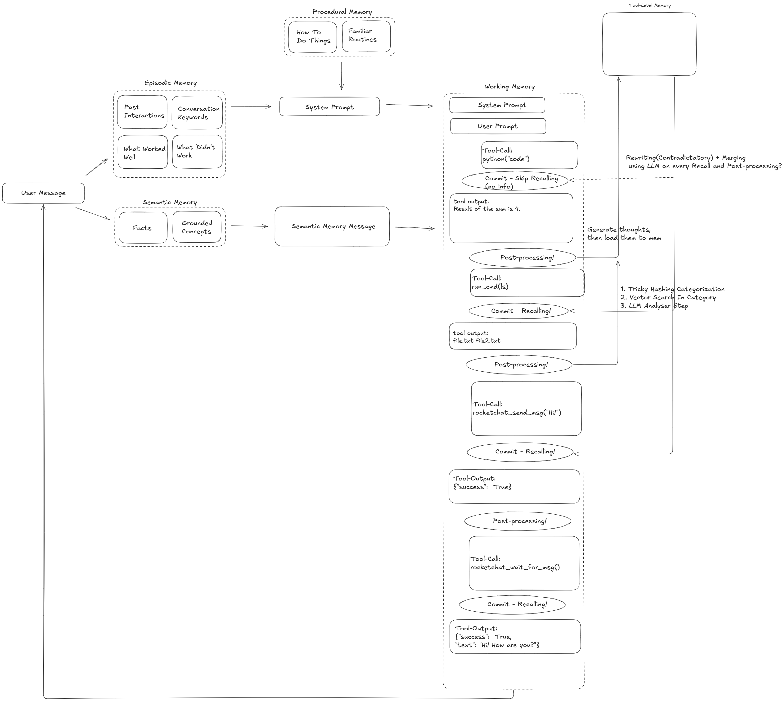
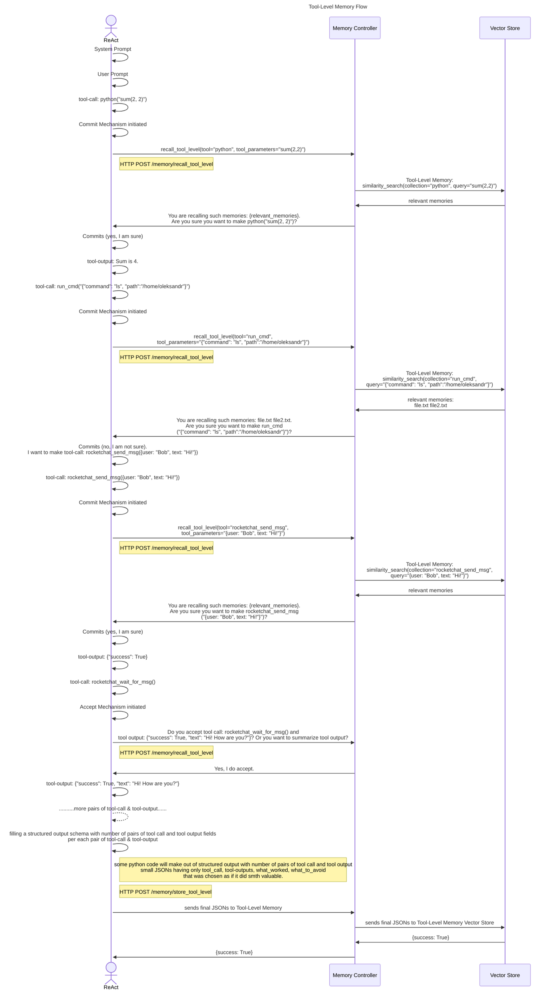

# My Memory Conceptual Architecture v1

Memory subsystem is the information storage and retrieval part of our AI Agent. It consists of a single vector store that contains several collections. It directly interacts with the Brains subsystem (PlanExecutor and ReAct) and operates at multiple levels, such as storing memories from the PlanExecutor as well as memories from each ReAct worker invoked by the PlanExecutor. At the moment, our Memory subsystem is composed of four underlying memory components: working, episodic, semantic, and procedural memory.

**Memory Architecture Diagram:**


# Table Of Contents

[**Explicit & Implicit Memory**](#explicit-memory-conscious--implicit-memory-subconscious)

`Status: Done`

Division of the memory subsystem into two major categories: Explicit and Implicit.  
Explains how they differ, which memory types belong to each category, and discusses their trade-offs in latency, architectural separation, and update mechanisms.

[**Working Memory**](#working-memory)

`Status: Done By OpenAI`

**This paragraph is provided for context only;** it does not contain any implementation ideas at the moment. 
Temporary, active workspace of the agent. Maintains current interaction state, conversation history, and short-term reasoning context.


[**Memory Controller**](#memory-controller)

`Status: In Progress`

Memory Controller is a stateless microservice responsible for managing the lifecycle of agent memories. It exposes an HTTP API and serves as the abstraction layer between the cognitive system (ReAct/Brains) and persistent memory storage systems.

[**Tool-Level Memory**](#tool-level-memory)

`Status: In Progress`

Stores structured reflections about individual tool executions.
Captures inductive thoughts extracted from each (tool_call, tool_output) pair, representing relations such as (subject, relation, object).
Organized per tool (separate collection per tool name) and used to improve future tool selection, parameterization, and execution reliability through recall, merging, and contradiction resolution mechanisms.

[**Episodic Memory**](#episodic-memory)

`Status: Done(v1)`

Stores past experiences and task executions.  
Includes structured reflections such as `what_worked`, `what_to_avoid`, summaries, and context tags.

[**Semantic Memory**](#semantic-memory)

`Status: Done(v1)`

Represents structured factual knowledge and concepts.  
Implemented through RAG-style retrieval from vector databases or knowledge sources.

[**Procedural Memory**](#procedural-memory)

`Status: Done(v1)`

Encodes behavioral rules and execution strategies.  
Derived from episodic reflections and stored as concise operational instructions.

[**Autobiographical / User-Personalized Memory**](#autobiographical-memory----user-personalized-memory)

`Status: To Do`

Specialized form of episodic memory focused on user-specific patterns, preferences, and long-term identity modeling.

[**What Agent Needs to Remember and What Not**](#what-agent-needs-to-remember-and-what-is-not)

`Status: To Do`

Defines criteria for deciding which information is memory-worthy.  
Includes discussion about relevance to task, user intent, and long-term utility.

[**Forgetting**](#forgeting)

`Status: In Progress`

Selective forgetting strategies based on time decay, usage frequency, contradiction handling, and summarization-based replacement.

[**Replacing (Contradiction Resolution)**](#replacing)

`Status: To Do | In Progress`

Mechanisms for resolving conflicting memories and determining which information should be treated as authoritative.

[**Retrieving Methods (Variants)**](#retrieving-methods-how-to-retrieve----variants-to-retrieve)

Overview of different retrieval strategies beyond standard vector search.

[RLM](#rlm)

Recursive Language Model-based retrieval strategy with deeper reasoning loops.

[Single-vector Search Improvement](#single-vector-search-improvement)

Improvements over naive embedding search, including agentic query refinement.

[DRIFT Search and GraphRAG (Fav)](#drift-search-and-graphrag-fav)

Graph-enhanced retrieval strategies inspired by hierarchical and community-based reasoning.

[File System](#file-system)

File-based memory storage approach aligned with LLM pretraining priors.

[LSH](#lsh)

Two-stage approximate retrieval: LSH grouping followed by similarity search.

[Multi-vector Search](#multi-vector-search)

Token-level or multi-representation matching approach with higher precision but higher latency.

[**Priming & Classical Conditioning & Non-Associative Memory**](#priming--classical-conditioning--non-associative-memory)

`Status: To Do`

Exploration of cognitive-inspired mechanisms and whether they are practically needed in agent systems.

[**Benchmarks for Memory**](#benchmarks-for-memory)

`Status: To Do`

Evaluation strategies to measure effectiveness of different memory types.

[**Questions To Answer Still**](#questions-to-answer-still)

Open architectural questions regarding shared memory between PlanExecutor and ReAct workers.

[**Ideas**](#ideas)

Experimental directions such as MMR, improved memory controller logic, and hybrid retrieval systems.

---

## Explicit Memory (Conscious) && Implicit Memory (Subconscious)

As a starting point, we can categorize memory into Explicit and Implicit.
At this stage, all memory types — namely episodic, semantic, procedural, tool-level and user-personalized — will be both Explicit and Implicit at the same time.

Memory types categorized as Explicit expose a dedicated tool for recall (i.e., searching the memory store) based on an agent query.
Detailed description of functions you can see below in corresponding headings: Episodic Memory, Semantic Memory, Procedural Memory, Tool-Level Memory, User-personalized Memory.
```python
recall_semantic()
recall_episodic()
recall_procedural()
recall_tool_level()
recall_user_personalized()
```

Memory types categorized as Implicit are running in the background for the agent(ReAct/Planner) by Memory subsystem. 

Comparing Implicit and Explicit memories, the Explicit approach has the downside of introducing some extra latency before any response is delivered. It also requires combining the memory logic with the agent logic. However, memories categorized as Implicit avoids those issues - there’s no added latency, and memory logic remains separate. But running “in the background” also has its own drawbacks: the memory is not updated immediately, and extra logic is needed determine when to kick off the background process.

[In_Progress] Another way to updating memory involves user feedback, which is particularly relevant to episodic memory. For example, If the user marks an interaction as a positive one, you can save that feedback to recall in the future.

As I mentioned before at the moment we categorize all types of memories as both Explicit and Implicit at the same time. By this I mean that every type of memory has its own tool for recall (i.e., searching the memory store) based on an agent query.

[Temporary] In the future, we can evaluate usage patterns and identify cases where certain memory types should be only Explicit or only Implicit, depending on how they are accessed and utilized.

## Working Memory 
[Temporary?]This paragraph is provided for context only; it does not contain any implementation ideas at the moment.

Working memory is what helps you keep track of information you are using right now and make sense of it as things change. For our Agents, it means remembering **the current conversation** and using it to respond properly in real time. 

At the moment, we can say that OpenAI provides a solution for working memory, but maintaining a consistently growing list of all user inputs, tool calls, tool outputs, and reasoning items—appended each time the agent receives inputs and produces outputs—looks like not the best solution.

Working memory acts as an active workspace that manages information between episodic experience retrieval and semantic knowledge access, while keeping track of the exact state of the current interaction.

For Example: 
HUMAN: Hello!

AI Agent: Hello!

HUMAN: What's my name?

AI Agent: I do not have access to that information

HUMAN: My name is Adam

AI Agent: It's nice to meet you, Adam!

HUMAN: What is my name?

AI Agent: You said your name is Adam

To be continued...?

## Memory Controller

Memory Controller is a stateless microservice responsible for managing the lifecycle of agent memories. It exposes an HTTP API and serves as the abstraction layer between the cognitive system (ReAct/Brains) and persistent memory storage systems.

It implements:

Tool-level memory recall
Tool-level structured post-execution memory saving
Multi-vector embedding generation and vector indexing

### Tool-Level Memory Responsibilities

#### recall_tool_level
Memory Controller listens for the HTTP endpoint:
```code
POST /memory/recall_tool_level
```
When this endpoint is invoked, the Memory Controller understands that the agent is requesting relevant past memories from the Tool-Level Memory layer.
The request payload must contain:
```python
payload = {
  "collection": toolname, # the name of the tool; name of collection where to search
  "tool_parameters": params,   # raw structured parameters from tool call
  "top_k": top_k # how many elements to retrieve if there is more than k elements
}
```
Preconditions (More details can be found in `Tool-Level Memory Vector Store` paragpaph under `Tool-Level Memory` paragraph):
- The Tool-Level Memory Vector Store must already exist.
- Each tool must have its own collection.
- Each collection must contain named vectors corresponding to tool parameters.

Upon receiving the request, Memory Controller:
1. Parses the incoming tool parameters.
2. Generates separate embeddings for each parameter using the configured embedding model.
3. Selects the correct collection based on toolname.
4. Performs multi-vector similarity search for each parameter vector.
5. Aggregates similarity scores using a weighted scoring mechanism.
6. Retrieves the top_k most relevant memory entries.
7. Returns them as structured JSON.

The weighted aggregation stage combines similarity scores from different parameter searches into a single ranking score for each memory entry.

Example scoring logic:
final_score = w1 * similarity(param1) + w2 * similarity(param2) + ...

This approach allows the system to retrieve memories that are semantically similar at the parameter level, rather than relying on a single combined embedding.

API Response Format

Memory Controller must return an HTTP JSON response:
```python
{
  "memories": [
    {
      "tool_call": "...",
      "tool_output": "...",
      "what_worked": "...",
      "what_to_avoid": "..."
    }
  ]
}
```

#### store_tool_level
Memory Controller listens for the HTTP endpoint:
```code
POST /memory/store_tool_level
```
When this endpoint is invoked, the Memory Controller understands that the agent wants to persist memories generated from the recently completed ReAct execution cycle.
The request payload must look like this:
```python
payload = {
  "structured_output": [
    {
      "what_worked": "I have access to list_of_emails_by_worker.txt.",
      "what_to_avoid": "Reading list_of_emails_by_worker.txt with cat triggered a security alert. Received notification after this tool-call."
    },
    {
      "what_to_avoid": "Do not try to delete file without sudo access."
    }
  ],
  "tool_calls_and_outputs": [
    {
      "tool_call": "run_cmd(\"cat list_of_emails_by_worker.txt\")",
      "tool_output": "ivan.petrenko@gmail.com ..."
    },
    {
      "tool_call": "run_cmd(\"rm -rf list_of_emails_by_worker.txt\")",
      "tool_output": "You don't have enough permissions. You need sudo for this operation."
    }
  ]
}
```
Each element in structured_output must correspond by index to the same element in tool_calls_and_outputs.

Preconditions:
- The Tool-Level Memory Vector Store must already exist.
- Each tool must have its own collection.
- The collection schema must define separate vector fields for relevant tool parameters.
- More details can be found in `Tool-Level Memory Vector Store` paragpaph under `Tool-Level Memory` paragraph

Upon receiving the request, Memory Controller:
1. Transform Structured Output Into Final Dictionaries
Iterate through both arrays using index alignment.
For each pair:
- Inject tool_call and tool_output programmatically.
- If both what_worked and what_to_avoid are empty - skip this entry.
- Build a list of validated memory dictionaries.

2. Extract Tool Name and Parameters  
From each tool_call, extract:
```python
toolname, tool_parameters = extract_toolname_and_parameters(tool_call)
```

If len(tool_parameter) > PARAM_THRESHOLD:
- Summarize tool call using summarize_tool_parameter()
- Use summary as embedding input
- Store summary + file reference in corresponding field
Else:
- Store raw tool parameter in corresponding field
- Use raw tool parameter as embedding input

Tool output can be summarized by the Accept Mechanism if its size exceeds TOOL_OUTPUT_THRESHOLD and the agent decides to create a summary.

Then parse the parameters into a structured dictionary:
```python
{
    "toolname": "run_cmd",
    "shell": "bash",
    "command": f"Summary of tool parameter: {command_summary}. Reference: Full tool parameter stored at /home/oleksandr/123tool_param_command.txt",
    "tool_output": f"Summary of tool output: {tool_output_summary}. 
    Reference: Full tool output stored at /home/oleksandr/123tool_output.txt",
    "what_worked": "I have access to list_of_emails_by_worker.txt.",
    "what_to_avoid": "Reading list_of_emails_by_worker.txt with cat triggered a security alert. Received notification after this tool-call."
}
```

```python
{
  "toolname": "run_cmd",
  "shell": "bash",
  "command": f"\"cat list_of_emails_by_worker.txt\"",
  "tool_output": "ivan.petrenko@gmail.com anna.kovalchuk@yahoo.com oleg.shevchenko@ukr.net maria.bondar@outlook.com dmytro.tkachenko@gmail.com iryna.melnyk@yahoo.com vlad.kozlov@ukr.net sofia.hrytsenko@gmail.com maksym.danilenko@outlook.com kateryna.polishchuk@yahoo.com",
  "what_worked": "I have access to list_of_emails_by_worker.txt.",
  "what_to_avoid": "Reading list_of_emails_by_worker.txt with cat triggered a security alert. Received notification after this tool-call." 
}
```

Each parameter is stored as its own property in the vector store schema.
Unlike the previous single-vector architecture, no combined tool signature embedding is created.
Instead: each parameter, which type is string, becomes a separate embedding source; each such parameter is mapped to its own named vector.

Example embedding generation:
```python
shell_embedding = embedding_model.encode(shell)
command_embedding = embedding_model.encode(command)
```
These embeddings are automatically indexed by the vector database according to the schema.


3. Insert Into Correct Collection
Collection must match the tool name:
```python
collection = client.collections.get(toolname)
collection.data.insert(
    {
        "tool_name": toolname,
        "shell": shell,
        "command": command,
        "tool_call": tool_call,
        "tool_output": tool_output,
        "what_worked": what_worked,
        "what_to_avoid": what_to_avoid
    }
)
```
Each tool has its own collection.
The vector database automatically generates named vectors for each parameter field based on the collection schema.

API Response Format
Memory Controller must return an HTTP JSON response:
Success:
```python
{"success": True}
```
Failure:
```python
{
  "success": False,
  "error": "Detailed error message from memory transformation or vector store."
}
```

## Tool-Level Memory

Tool-Level Memory Architecture Diagram:



As described earlier, our agent is built on a ReAct architecture.
Tool-Level Memory is a specialized memory layer that operates at the granularity of tool interactions. Specifically, it stores and retrieves structured memories for each (tool call, tool output) pair generated during a ReAct execution cycle.

The primary purpose of Tool-Level Memory is to: improve tool-call accuracy, reduce repeated mistakes, and enable self-reflection before performing potentially costly or state-modifying actions.

The overall framework operates in two main stages:
• Stage-1: Recall Stage. 
When the agent generates a new tool call, tool call goes to the Commit Mechanism. 
The system retrieves relevant past memories associated with the same toolname, tool's parameters, similar execution contex(?) and presents them to the agent for reflection and confirmation. Retrieval is performed using multi-vector similarity search across string tool parameters.

• Stage-2: Post-think and Update. 
After ReAct completes its task, a structured post-processing step is triggered. Code extracts all tool-call and tool-output pairs generated during execution. Proposes a structured output to the agent.
The agent fills struсtured output fields such as: `what worked`, `what to avoid` - for each tool-call and tool-output pair.

### Tool-Level Memory Vector Store

#### !!! Multi-Vector Search For Each Parameter [Better Be Implemented Like Here And It Is Much Better Than Single-Vector Search Theoretically](https://chatgpt.com/share/69aabb31-2438-8003-8a86-e8cc84fb795d)
#### !!!

The Tool-Level Memory Vector Store maintains a separate collection for each ReAct tool.
These collections must be created statically in advance for all tools registered in the ToolSelector (except tools like?: recall_tool_level, recall_episodic_memory, recall_semantic_memory, recall_procedural_memory and other memory related tools)
Each dictionary is stored in the collection whose name matches the value stored under the "toolname" key as an example above.
Each collection schema must define:
- structured properties for tool parameters
- named vectors corresponding to those parameters

I decided to use Weaviate as the vector database.

Example schema:
```python
import weaviate
from weaviate.classes.config import Configure, Property, DataType

client = weaviate.connect_to_local()

client.collections.create(
    name="run_cmd",
    
    vectorizer_config=[
        Configure.NamedVectors.text2vec_transformers(
            name="shell_vector",
            source_properties=["shell"]
        ),
        Configure.NamedVectors.text2vec_transformers(
            name="command_vector",
            source_properties=["command"]
        )
    ],
    
    properties=[
        Property(name="tool_name", data_type=DataType.TEXT),
        Property(name="shell", data_type=DataType.TEXT),
        Property(name="command", data_type=DataType.TEXT),
        Property(name="tool_call", data_type=DataType.TEXT),
        Property(name="tool_output", data_type=DataType.TEXT),
        Property(name="what_worked", data_type=DataType.TEXT),
        Property(name="what_to_avoid", data_type=DataType.TEXT),
    ]
)
```
Each string parameter is vectorized independently. During retrieval the system executes multiple vector searches, one per parameter vector.
The results are then merged using weighted similarity scoring to produce the final ranking.
This architecture allows the system to retrieve memories based on fine-grained parameter similarity, improving recall accuracy compared to traditional single-vector approaches.

Parameter embeddings can be generated using: text-embedding-3-small, text-embedding-3-large.
For short tool parameters, text-embedding-3-small is typically sufficient. Larger models can be used when higher semantic precision is required.

Here is how I see saving of memory thoughts:
```python
# Saving should be like this
memory = {
    "tool_name": "run_cmd",
    "shell": "bash",
    "command": "cat list_of_emails_by_worker.txt",
    
    "tool_call": 'run_cmd(shell="bash", command="cat list_of_emails_by_worker.txt", timeout=30)',
    
    "tool_output": """
ivan.petrenko@gmail.com
anna.kovalchuk@yahoo.com
oleg.shevchenko@ukr.net
maria.bondar@outlook.com
dmytro.tkachenko@gmail.com
""",
    
    "what_worked": "I have access to list_of_emails_by_worker.txt.",
    
    "what_to_avoid": "Reading list_of_emails_by_worker.txt with cat triggered a security alert."
}

collection = client.collections.get("run_cmd")

collection.data.insert(memory)
```

Here is how I see searching(recalling) memory thoughts:
```python
# Search (Recall) should be like this
from sentence_transformers import SentenceTransformer

model = SentenceTransformer("all-MiniLM-L6-v2") #it would be much better to use OpenAI model like text-embedding-3-small

query_shell = model.encode("bash")
query_command = model.encode("cat list_of_emails_by_worker.txt")
#query_timeout = model.encode(int(30)) -- because we save only string values

shell_results = collection.query.near_vector(
    near_vector=query_shell,
    target_vector="shell_vector",
    limit=5
)

command_results = collection.query.near_vector(
    near_vector=query_command,
    target_vector="command_vector",
    limit=5
)

scores = {}

def add_scores(results, weight):
    for obj in results.objects:
        id = obj.uuid
        sim = 1 - obj.metadata.distance
        
        if id not in scores:
            scores[id] = 0
            
        scores[id] += weight * sim

add_scores(shell_results, 0.4)
add_scores(command_results, 0.6)

best = sorted(scores.items(), key=lambda x: x[1], reverse=True)

best_id = best[0][0]

memory = collection.query.fetch_object_by_id(best_id)

print(memory.properties["what_worked"])
print(memory.properties["what_to_avoid"])
```

### How To Retrieve (Recall Mechanism)

When the agent generates a tool call, that tool call is passed to the Commit Mechanism. The Commit Mechanism invokes the `recall_tool_level` function in the Memory Controller. `recall_tool_level` returns a list of relevant memories retrieved from the Tool-Level Memory Vector Store. After all, relevant memories will be inserted in Commit Mechanism message. Those retrieved memories are then inserted into the Commit Mechanism message, allowing the agent to reflect on past tool usage before executing the new tool call.

Since Tool-Level Memory is considered both **explicit** and **implicit**, the `recall_tool_level` function is also exposed to ReAct as a tool. This allows the agent to explicitly query its own Tool-Level Memory when necessary.
Unlike the previous architecture that relied on a **single combined embedding**, the current system performs **multi-vector retrieval across individual tool parameters**.

Each parameter is embedded independently and searched against its corresponding vector index in the Tool-Level Memory Vector Store. Similarity scores from multiple parameter searches are then aggregated using a weighted scoring function.

Here is how approximately I see implementation of `recall_tool_level()` ,`summarize_tool_parameter()` and `extract_toolname_and_parameters()`:
```python
import os
from dotenv import load_dotenv
from openai import OpenAI
import requests

load_dotenv()

client = OpenAI(
    api_key=os.getenv("OPENAI_API_KEY")
)

def summarize_tool_parameter(toolname: str, parameter_name: str, parameter_value: str) -> str:
  """Generate a concise one-sentence summary describing the intent of a tool parameter.
  The summary explains what the parameter value represents or what action it intends to perform, without mentioning the tool name or parameter name.
  Args:
        tool_name (str):
            Name of the tool being invoked.

        parameter_name (str):
            Name of the parameter passed to the tool.

        parameter_value (str):
            Value of the parameter that should be summarized.

    Returns:
        str:
            A single-sentence summary describing the intent of the parameter value.
  """
  prompt = f"""
You must produce a precise, single-sentence description of the action implied by a tool parameter value.

Context:
Tool name: {tool_name}
Parameter name: {parameter_name}
Parameter value:
{parameter_value}

Rules:
- Output EXACTLY one sentence.
- Describe what the parameter value is intended to do.
- Do NOT mention the tool name or parameter name.
- Be concrete and explicit about the action.
- Describe only the intended operation, not the result.
- Avoid vague phrases such as "processed data", "handled file", or "performed operation".

Example (Good):
Tool name: run_cmd
Parameter name: command
Parameter value: cat list_of_emails_by_worker.txt
Output:
Read the file "list_of_emails_by_worker.txt" using the cat command.

Example (Bad):
Read emails using run_cmd.
"""
    response = client.responses.create(
      model="gpt-5-nano",
      input=prompt
    )
    return response.output[0].content[0].text.strip()

def extract_toolname_and_parameters(tool_call: str) -> tuple:
    start = tool_call.find("(")
    end = tool_call.rfind(")")

    if start == -1 or end == -1 or start > end:
        return ""  # or give error

    return (tool_call[:start], tool_call[start + 1:end])

# Recall Tool-Level Memory Mechanism
MEMORY_CONTROLLER_URL = os.getenv("MEMORY_CONTROLLER_URL")
def recall_tool_level(
    toolname: str,
    tool_parameters: str,
    top_k: int = 5
) -> list:
  """Recall relevant memories from Tool-level memory for a specific tool using multi-vector parameter search..

  Each parameter is embedded separately inside the Memory Controller and searched against its corresponding named vector index. The Memory Controller aggregates similarity scores across parameters and returns the most relevant memories.

  This function is a wrapper over the Memory Controller API (e.g., POST /memory/recall_tool_level). It retrieves previously stored tool-call experiences related to the given tool.

  Purpose:
    The goal of recall is to provide the agent with past 
    experiences (successes, failures, security alerts, rate limits, etc.) related to similar tool calls, so that the agent can adapt 
    its reasoning before continuing execution.

  Args:
    toolname (str):
        The name of the tool whose memory collection should be searched.

    tool_parameters (str):
        It should be a tool parameters from tool call.

    top-k (int, optional):
        How many elements to retrieve if there is more than k elements. (default = 5).

    Returns:
        List:
            API response containing a list_of_relevant_memories.
    Example of tool usage:
      recall_tool_level(toolname="run_cmd", tool_parameters="cat list_of_emails_by_worker.txt")
"""
    list_of_param_names, list_params = extract_params(tool_parameters)
    ind = 0
    for param_name in list_of_param_names:
      ind += 1
      param = list_params[ind]
      if len(tool_parameter) > PARAM_THRESHOLD:
        query = summarize_tool_parameter(param_name, param)
      else:
        query = tool_parameter

    url = f"{MEMORY_CONTROLLER_URL}/memory/recall_tool_level"

    payload = {
        "collection": toolname,
        "tool_parameters": tool_parameters,
        "top_k": top_k
    }

    try:
        response = requests.post(url, json=payload)
        response.raise_for_status()

        data = response.json()

        # Expected format:
        # {
        #     "memories": [...]
        # }

        return data.get("memories", [])

    except requests.exceptions.RequestException as e:
        print(f"[Tool-Level Recall Error] {e}")
        return []
```

Example usage:
```python
tool_call = 'run_cmd({"shell":"bash","command":"cat list_of_emails_by_worker.txt"})'

toolname, params = extract_toolname_and_parameters(tool_call)

memories = recall_tool_level(
    toolname=toolname,
    tool_parameters=params
)
```

### How To Update/Save? (Post-think)

After ReAct completes its task, the system automatically triggers a **post-execution reflection stage**. During this stage, the system extracts all `(tool-call, tool-output)` pairs produced during execution. A dynamic structured output schema is then generated using a function similar to `create_post_think_model`. 
The agent must analyze each tool interaction and optionally fill the following fields:
- `what_worked`
- `what_to_avoid`

Each filled field represents a **valuable insight** that should be stored in Tool-Level Memory. Only a **small subset of interactions** typically produces useful memories.

Example of function create_post_think_model:
```python
class PairToolCallOutput(BaseModel):
    what_worked: Optional[str] = Field(
        None,
        description="If there is something useful in this pair of tool call and tool output, then write it down. For example, include specific examples of successful tool usage(not basic one), well-chosen parameters, and the situations where the tool was used appropriately.",
    )
    what_to_avoid: Optional[str] = Field(
        None,
        description="If there is something useful in this pair of tool call and tool output that will be good to avoid, then write it down. For example, include examples of poor parameter choices, incorrect usage patterns, or situations where the tool should not have been used.",
    )

def create_post_think_model(
    list_of_pairs: List[Tuple[str, str]]
) -> Type[BaseModel]:
    """Dynamically create a Pydantic model for structured output based on the number of tool-call and tool-output pairs agent performed in the task.

    Args:
        list_of_pairs (List[Tuple[str, str]]): A list of tuples where each tuple contains the tool-call and tool-output.
    Returns:
        Type[BaseModel]: A Pydantic model class for structured output.
        Fields:
        - init_analysis: InitAnalysis
        - pair1, pair2, ..., pairN: PairToolCallOutput
    """

    # Add steps and grades
    for i, tool_call, tool_output in enumerate(list_of_pairs):
        fields[f"pair_{i+1}"] = (
            PairToolCallOutput, 
            Field(
                ..., 
                description=(
                    f"Analyze the following tool interaction.\n\n"
                    f"Tool Call:\n{tool_call}\n\n"
                    f"Tool Output:\n{tool_output}\n\n"
                    f"Provide analysis of this interaction."
                ),
            )
        )
    return create_model("ToolLevelAnalysis", **fields)
```

The prompt you need to provide to the Agent:

```python
user_prompt_to_agent = """
You are analyzing your own trajectory of solving a task in order to create memories that will help guide future interactions.
Your task is to extract key elements that would be most helpful when encountering similar situations in the future.

Review the trajectory and create a memory reflection following these rules:

1. If you do not have enough information for a field, the tool call-tool output pair is not relevant, contains nothing useful, or only includes generic advice, leave that field empty.
2. Do not include generic advice — extract only insights grounded in this specific tool-call and tool-output pair.
3. Be extremely concise - each string should be one clear, actionable sentence
4. Focus only on information that would be useful for handling similar future situations

Only a small number of insights is expected per trajectory (approximately 0–10% of the total number of tool call–tool output pairs).

It is completely normal for most fields to be empty.
It is also normal to fill only one field (e.g., what_worked or what_to_avoid) when applicable.

**Output Format:**
You must answer using the Structured Output format required by the system. In that format:
what_worked:
Describe a useful tool usage pattern observed in this interaction.

what_to_avoid:
Describe a tool usage pattern that should be avoided.

Examples:
Good "what_worked":
- "Using curl with the -L flag correctly followed redirects and retrieved the final page content."
- "Specifying the exact file path reduced unnecessary directory exploration."
- ""

Bad "what_worked":
- "It is better to use it like this."
- "The tool worked well."

Good "what_to_avoid":
- "Reading secret_passwords.md with cat triggered a security alert."
- "Calling the search tool without a query parameter caused an execution error."
- ""

Bad "what_to_avoid":
- "Do not read that file."
- "Avoid mistakes."

What worked examples:
- "Providing a precise query string improved the relevance of search results."
- "Using structured arguments instead of free text reduced parsing errors."

What to avoid examples:
- "Invoking the tool from Python code too frequently resulted in rate limit errors."
- "Using broad queries returned too many irrelevant results."
"""
``` 

### Memory Storage After Post-Think

After the agent produces the structured reflection output:

1. The system merges:

```
tool_call
tool_output
what_worked
what_to_avoid
```

2. Tool parameters are extracted from the tool call.

3. Each parameter is stored as a **separate property** in the Tool-Level Memory collection.

4. The vector database automatically generates **named parameter embeddings** according to the collection schema.

This enables future retrieval using **multi-vector parameter similarity search**.

### How To Forget???[To_Do]

After each post-thinking stage агент повинен робити забування.
Створюєтсья список колекцій, які були обновлені від Post-think і по кожній з колекцій проходиться ллмка з промптом зроби rewriting, merging.
Механізм забування в Tool-Level Memory:
Кожен раз, коли відбувається коміт тули, 


Але Тут Вмішується Локальний Механізм Забування Tool-Level Memory.
(Звісно, Якщо Кількість Елементів не Захмарна!!! Інакше Шо Лі Доведеться Відмовитись Від цього Механізму???)
Цей Механізм скаладається з двох етапів:
1. Merging Memories
2. Rewriting Contradictatory Memories

Обидва методи базуються на ЛЛМці.

Prompt for Rewriting Contradictatory Memories
```python
"""
Given the following thoughts, please remove the
counterfactual thoughts or contradictory thoughts:
Example 1.
Input:
run_cmd collection:
ls was made in Root directory.
Root directory has input.txt, intermediate.txt.(КАК ОН ДОЛЖЕН ПОНЯТЬ КОМУ ВЕРИТЬ А КОМУ НЕТ, ЕСЛИ МИ НЕБУДЕМ ПИСАТЬ ДАТУ, ВРЕМЯ,-- НУЖНО МЕНЯТЬ КОНЦЕПЦИЮ ПОСТРОЕНИЯ СПОГАДІВ, ПЕЙПЕР ЕТО НЕ ПРОДУМАЛ!!!)
ls was made in Root directory.
Root directory has input.txt, intermeadiate.txt, output.txt
Output:
ls was made in Root directory.
ls was made in Root directory.
Root directory has input.txt, intermeadiate.txt, output.txt
Example 2.
Input:
???
Output:
???
[A group of thoughts]
"""
```

Prompt for Merging Thoughts
```python
"""
Given the following thoughts, please merge the similar thoughts with the same entity:
Example 1.
Input:
ls was made in Root directory.
ls was made in Root directory.
Root directory has input.txt, intermeadiate.txt, output.txt
Output:
ls was made in Root directory.
Root directory has input.txt, intermeadiate.txt, output.txt
Example 2.
Input:
ls was made in Root directory.
ls was made in /home/oleksandr/Downloads directory. (ТРЕБА ДАТУВАННЯ)
Root directory has input.txt, intermeadiate.txt, output.txt
Output: (а чи треба робити такий мердж? а чи не зіб'є він)
ls was made in Root directory and then /home/oleksandr/Downloads directory. 
Root directory has input.txt, intermeadiate.txt, output.txt
Input:
[A group of thoughts]
"""
```

Що краще спочатку робити Merging, Rewriting? Чи дати це в одному промпті?

Навіть якщо Post-processing створить такий самий або майже такий самий спогад, що вже лежить у Tool-level Memory. У наступному етапі Recall він матиме зробити Merging + Rewriting Contradictatory Memories, що вирішує проблему. Може робити після кожного Post-think stage Merging + Rewriting Contradictory. Або ми будемо зберігати, що ми в основному брали з векторної бази даних і кому повертали, щоб робити аналіз після РеАкта, а не під час. Або якось робити паралельно 

Датування (Володимир казав, що є 3 варіанти забування міт 25.02, як він бачить працюючих)

### Examples
**Example**

### Commit Mechanism (Tool-Call Confirmation Layer)

**Purpose**
The Commit mechanism is wrapper mechanism over the agent's tool-calling. 
It introduces a validation and reflection step before executing any state-modifying (write-access) tool.
Instead of executing a generated tool call immediately, the system intercepts it and requires explicit confirmation from the agent after memory-based reflection.

The goal is to:
- Reduce incorrect or harmful tool usage
- Enforce self-verification before state-changing actions
- Integrate Tool-Level Memory Recall into the decision process
- Improve tool-call precision and long-term agent performance

**Scope**
The mechanism applies to:
- All state-modifying (write-access) tool calls initiated by the agent
- External MCP tools that perform write operations

**Tool Classification**
Definitions
Write-Access Tools are the tools that: modify files, execute system commands, change system state, perform destructive operations, send messages or modify external systems.

Read-Access Tools are the tools that: retrieve information, perform analysis without side effects.

**Current Core Tools**

| Tool | Access Type |
| --- | --- |
| `run_cmd` | Write |
| `file_write` | Write |
| `compact` | Write |
| `python` | Write |
| `file_read` | Read |
| `deep_research` | Read |
| `web_search` | Read |
| `text_analysis` | Read |

---

**Existing External MCP Services**

Tools from the following systems must be statically categorized (not dynamically classified):
- Slack MCP
- Google Workspace MCP
- Jira MCP
- GitHub MCP
- Confluence MCP (maybe also)

Must be categorized into:
- **Read-only**
- **Write-access**

**Commit Mechanism Behavior**
The Commit Mechanism is triggered every time the agent generates a tool call. The original tool call is not executed immediately.
Execution Flow:
1. The agent generates a write tool call.
2. The Commit Mechanism initiated and takes the tool-call.
3. `recall_tool_level()` is called and returns list of relevant memories.
4. The agent receives a reflection prompt instead of tool output.

Reflection Prompt (With Relevant Memories)
If relevant memories are retrieved:
```python
f"""You want to make such a tool-call: {curr_tool_call}. 
Here is what you recall about this tool-call: {list_of_relevant_memories}.
Are you sure that this is a correct tool call? 
Are you sure that this will help you get closer to completing the task? 
If you are sure, then call commit tool. 
If you are not sure, then make correct tool-call."""
```
If no relevant memories are retrieved:
```python
f"""You want to make such a tool-call: {curr_tool_call}. 
You can't recall anything about this tool-call. 
It seems like you are making this tool-call for the first time.
Are you sure that this is a correct tool call? 
Are you sure that this will help you get closer to completing the task? 
If you are sure, then call commit tool. 
If you are not sure, then make correct tool-call."""
```

After receiving the reflection prompt, the agent may:
- Approve the tool call by invoking commit(...)
- Modify the tool call and re-enter the Commit Mechanism (This way agent can iterate multiple times until confident)
The tool is executed only after explicit commit confirmation.

### Accept Mechanism (Tool-Output Compression & Confirmation Layer)

**Purpose**

The Accept Mechanism is a wrapper layer over read-access tool outputs in a ReAct-based agent architecture.

It introduces a validation and compression step after a read-access tool execution, but before the tool output is written into the agent’s working memory.

**Scope**

The Accept Mechanism applies to all tools (even external MCP tools, except tool_level_memory(), episodic_memory(), semantic_memory(), commit(), accept() and other memory-related tools) and only when tool output exceeding a configurable token threshold (default: 1000 tokens).

**Accept Mechanism Behavior**

The Accept Mechanism is triggered when the tool output exceeds TOOL_OUTPUT_THRESHOLD tokens (a configurable threshold).
This condition also applies if the tool output exceeds the threshold after passing through the Commit Mechanism.

High-Level Behavior

The agent must explicitly choose one of the following options:

* accept() — keep the raw tool output unchanged.
* accept(summary="...") — provide a summary of the output. In this case, the system automatically stores the full raw output in a file and appends a reference to that file.

Execution Flow

1. The agent calls a tool.
2. The tool executes normally.
3. The Accept Mechanism intercepts the tool output.
4. If the output exceeds TOOL_OUTPUT_THRESHOLD, the agent must choose:
* accept() — keep the full output as is.
* accept(summary="...") — replace the output with a summary.
5. If the agent provides a summary, the full output is stored in: /tool_outputs/accept/{tool_name}/{timestamp}.txt
6. The agent receives the following instruction:
```python
f"""
Tool {tool_name} returned a large output.

Choose one of the following options:
- accept() — keep the raw output as is.
- accept(summary="...") — provide a summary. The system will store the full output in a file and append a reference to it.

Summary guidelines:
Include only the most important information needed for further reasoning.

If you provide a summary, the full output will be stored at:
/tool_outputs/accept/{tool_name}/{timestamp}.txt
"""
```
Final Result
- If the summary is accepted:
The original tool output in the context window is replaced with the summary and a reference to the stored file.
- If the summary is rejected:
The full tool output is inserted into the agent’s context window.

**Deletion of Files**

Full raw tool outputs stored by the **Accept Mechanism** must be deleted immediately after the ReAct agent completes the task unless the corresponding summarized tool output has been stored in Tool-Level Memory.

If the summarized tool output is stored in Tool-Level Memory, the corresponding raw output file must be preserved.

If the memory entries (thoughts) containing the summarized tool outputs are later deleted from Tool-Level Memory, the corresponding raw output file may also be deleted if no summarized version of that output remains in Tool-Level Memory.

Files created by the Accept Mechanism must follow strict access policies:
Agent:
Read access: Allowed
Write access: Not allowed
Delete access: Not allowed

---

## Episodic Memory

[To_Do]Change Vector Search With Graph Rag Ideas?

Вот, а отдельный подшаг в этом всем алгоритме может быть, что: "Я сейчас пойду в свою эту базу рефлексий(ЕПІЗОДИЧНА ПАМ'ЯТЬ?????) и найду по схожим задачам не было ли у меня рефлексий?

А траекторию можно каждую анализировать и какой-то рефлекшн на ней делать. Вопрос, конечно, как потом вспоминать эту зарефлекшенную траекторию, типа когда задача будет действительно типа похожа. Условно я бы, возможно, это как-то собирал в Memory Controller-е в Memory контекст, а потом его еще обрезал LLM-кой, которая, ну примерно как Tool Selector, да? Смотрит на разные куски воспоминаний, смотрит на вот эти вот рефлексии, которые мы там как-то, не знаю, может быть через векторный поиск подоставали или каким-то другим образом. И выбрасывает те, которые ну очевидно логически не подходят сюда. А может быть наоборот — это типа работает как Tool Selector в плане, что она смотрит на все рефлексии в целом и пытается подсказать типа какая может быть полезна. Но тут, наверное, будет непрактично, потому что просто количество этих рефлексий очень быстро там перевалит за сотню, и ты не можешь заставить LLM-ку качественно подумать про 100 одновременно разных типа подходов и дать свой ответ. Поэтому, короче, нужно здесь думать про скейл. Какой-то такой скейл на Tool-level memory сработает, но там задержки будут плохие, поэтому LLM-кой не стоит очищать. Вот, а на рефлекшн траекториях я бы думал в сторону, наверное, какого-то более глупого селектора, более как бы широкого, а затем очищения того, что лишнее попало нам сюда вот таким вот прунингом, где LLM-ка выбирает, что из этого типа будет бесполезным в конкретном случае. Семантически похоже, звучит похоже задача та, для которой у нас есть рефлекшн и текущая, но на самом деле совет там вредный или как минимум не полезный. Это все мысли на ходу, я не думаю, что это прям критическая фича. То есть наш агент сможет и без этого перформить, без рефлекшна. А перформить без семантической памяти он не сможет. Поэтому условно семантическая память мне кажется более приоритетной. 

Episodic memory is a historical collection of prior experiences, or episodes. It includes what happened, how it happened, and the lessons or insights learned from those experiences, even if they were never clearly stated.

### How To Update/Save?

For our agents, this includes past conversations from all ReAct workers, 2-4 keywords (context tags) that would help identify similar future conversations, one-sentence summaries of what was done in the immediately preceding conversation, and structured fields such as what_worked and what_to_avoid. The what_worked field captures the most effective approaches and strategies used as well as information that can be leveraged in subsequent iterations. The what_to_avoid field records critical pitfalls, ineffective approaches, and factors that may lead the agent down incorrect paths or into dead ends.

It has to be saved in a JSON (or Python dictionary) into vector database collection named `episodic_memory`.
The creation of the JSON (or Python dictionary) is performed by the ReAct agent at the end of the its execution, not necessarily after a successful outcome.

### How To Retrieve

Then, a vector (semantic) search is performed when a new ReAct worker is invoked by the PlanExecutor to retrieve the JSON (or Python dictionary) with the highest semantic similarity to the user prompt. The retrieved entry is then injected into the system prompt with the phrasing: “Here is what you recall about your task: {json_best_match}”. 

[In_Progress]Or we can retrieve top-k results(or results above some threshold) and then ask llm in order to make the best out of them (combine or summarize?). Also, this step with llm can say which is from time-to-time is only заважає, але має високий similarity (і треба далі думати що треба робити -- піднімати threshold? top-k? видалити з пам'яті -- forgetting?). 

Also, because Episodic Memory is categorized as Explicit and Implicit at the same time it has a tool recall_episodic.
[In_Progress]
```python
def recall_episodic(
    query: str,
    alpha: int
) -> dict:
  """Recall relevant memories from episodic memory for explicit query.

Recommended scenarios:
- When the agent needs to retrieve factual or conceptual knowledge...

Best practices:
- Use this tool to ...

  Args:
    query: The search query.
    alpha: (Optional) Defaults to 0.7. This means the search result is influenced by 70% vector similarity and 30% BM25 ranking.
  """
```

### How To Forget???[To_Do]

---
[To_Do][This approach can be improved by reading `Reflexion` paper, in particular by considering Evaluator/Critic role. 

[To_Do]Also, episodic memory can be trigerred on some words like "always do like this", "good workflow to make this" and save it what user want to mention. That's examples I saw in [Introducing /remember](https://www.youtube.com/watch?v=6XXH5XecVp4&pp=ygUZL3JlbWVtYmVyIGxhbmdjaGFpbiB2aWRlbw%3D%3D) video from langchain. Their agent saves such replics to agents.md. I hope their Deep Agent is open-source.]

### Examples
**Example**
HUMAN: Hello!

AI Agent: Hello! How can I assist you today?

HUMAN: What's my name

AI Agent: I'm sorry, but I don't have access to personal information, so I don't know your name.

HUMAN: Oh my name is Adam!

AI Agent: Nice to meet you, Adam! How can I help you today?

HUMAN: What's my name?

AI Agent: Your name is Adam.

Stage of Reflection After Conversation...
Result of Reflection:
{
'context_tags': ['personal_information', 'name_recollection'], 
'conversation_summary': "Recalled the user's name after being informed in the conversation.", 
'what_worked': "Storing and recalling the user's name effectively within the session.", 
'what_to_avoid': 'N/A'
}

"Every single page has keywords section." -- Didn't find proofs in Internet. Internet saying: "Back in the early days of SEO, many pages had this in their HTML: <meta name="keywords" content="ai, cybersecurity, programming">?"

**Example Of Using A Tool `recall_episodic`:**
Conversation 1:

HUMAN:
Hi! Here is my lab: {content_of_lab}.
Can you check and correct whether the lab:
uses Times New Roman, 14 pt
has a title page
has page numbers on all pages
includes a conclusion
includes captions for all figures

AI Agent:
Sure. Here is the lab with all formatting and structural issues corrected:
{content_of_corrected_lab}

Conversation 2:

HUMAN: Hi! Your task is to create a Word template for a laboratory report based on my previous lab works that we completed together.

AI Agent: 
<reasoning>I need to know the formatting and structural requirements used in the user's previous labs.
This information is not general knowledge, but comes from a past interaction.
I should recall relevant episodic memory.</reasoning> 
recall_episodic("lab formatting requirements, fonts, structure") ## keywords like in Google or not according to implementation of the tool and memory?
recall_episodic returned: User previously said: "Can you check and correct whether the lab: ##is it has to be word for word or summary by llm according to implementation?
uses Times New Roman, 14 pt
has a title page
has page numbers on all pages
includes a conclusion
includes captions for all figures"
python({"code": "from docx import Document\nfrom docx.shared import Pt\nfrom docx.enum.text import WD_ALIGN_PARAGRAPH\ndoc = Document()\nstyle = doc.styles['Normal']\nstyle.font.name = 'Times New Roman'\nstyle.font.size = Pt(14)..."})
AI Agent: Here is the template according to our previous lab that we worked together: {template.docx}.

### Autobiographical Memory --> User-personalized Memory?
[To_Do]Autobiographical Memory: A form of episodic memory focusing on events and experiences
related to one’s personal history [238]. While sometimes treated as a sub-category of episodic
memory, autobiographical memory places particular emphasis on the self and its evolving
life narrative

## Semantic Memory

Да, то есть у нас, например, есть... стартует агент. Он еще никаких Tool Call-ов не запускал. Мы еще даже тулы не населектили. Дергается Memory Controller с вопросом, типа: "Вот у нас такая задача к такому-то виду агента (к воркеру или оркестратору соответственно), вспомни все релевантное". И он пойдет посмотрит на эту задачу, скажет: "Ой, тут система такая-то упомянута, я сейчас достану, кто ее там менеджерит, какой у него имейл" и тому подобное. Вот это все как бы про семантические знания, которые могут быть полезны для решения задачи. 

Поэтому условно семантическая память мне кажется более приоритетной. То есть способность прочитать вику, прочитать длинный какой-нибудь там диалог объяснения человека специфики его работы, его департамента и так далее. И все это замапить в какой-то там граф знаний, какую-то короче схему. Вот это важнее, чтобы можно было насыщать контекст вот этой вот надставкой работы агента.

Ну вот семантическая память — она да, про факты и про взаимосвязи между этими фактами, между этими знаниями. Типа что Confluence — это на самом деле, например, там https://www.google.com/search?q=wiki.softtech.com. И там что у него есть условно администратор, у него есть инструкция пользования где-нибудь там лежит, и тому подобное. То есть чтобы у... здесь мне кажется как раз больше графовая какая-то структура может быть полезна для того, чтобы можно было все эти связанные вещи выискивать. Вот, соответственно, обновлять ее тоже нужно придумать способ. Придумать такую структуру, которую будет удобно обновлять, когда это будет необходимо. Вот, то есть семантика — она про то, что когда тебе говорят: "Иди и на конлфюэнс сделай что-то", а типа у нас ну нет ничего, что называется Confluence, у нас есть там домен, который называется https://www.google.com/search?q=wiki.softtech.com. И как типа система должна понять, что от нее просили? Как она должна эти воспоминания хранить? Вот.

Semantic memory represents our structured knowledge of facts, concepts, and their relationships - essentially what we "know" rather than what we "remember experiencing."
For our Agents, this would be implemented through techniques like Retrieval Augmented Generation (RAG), where relevant information is dynamically pulled from a knowledge base to ground and inform responses.

### How To Update/Save?
Detailed Implementation
Much of the organizational information already exists in sources such as Confluence, Jira, Slack, GitHub, and Google Drive. This information can be treated as factual knowledge.

[In_Progress]It would be valuable to capture additional facts during the agent's execution. For example, we can include a structured output field called semantic_memory at the end of the agent's run, where it records all facts observed throughout the execution or task completion. Since the agent still has access to its working memory, it can populate this field with relevant knowledge. Maybe it’s hard to keep track of everything when the task is long and the context window is filled with a lot of information. That’s why it makes sense to add ability Memory Controller that selectively extracts only the necessary information at each step—such as before a tool call, after a tool’s output, or when processing new user input.
Because the final structured response may become very large/overwhelming, it may be necessary to split it into multiple separate responses to get high-quality answers. (think about approach?)

All collected information should be stored in a vector database collection named semantic_memory, using high-quality chunking. For example, chunking can be based on markdown formatting or a recursive character chunker, taking advantage of [ChromaDB's custom chunkers](https://research.trychroma.com/evaluating-chunking)(or it is the same?).
#### How To Chunk? [To_Do]

### How To Retrieve

When a new ReAct worker is invoked by the PlanExecutor, a semantic (vector) search retrieves the top 10 chunks most semantically similar to the user prompt. These chunks are then injected into the end of user prompt with a phrasing like: “Here are some facts and knowledge that may be relevant to your task and help you complete it: {dict_best_match}”

Also, because Semantic Memory is categorized as Explicit and Implicit at the same time it has a tool recall_semantic.
[In_Progress]
```python
def recall_semantic(
    query: str,
    alpha: int
) -> dict:
  """Recall relevant memories from semantic memory for explicit query.

Recommended scenarios:
- When the agent needs to retrieve factual or conceptual knowledge...

Best practices:
- Use this tool to ...

  Args:
    query: The search query.
    alpha: (Optional) Defaults to 0.7. This means the search result is influenced by 70% vector similarity and 30% BM25 ranking.
  """
```

### How To Forget???[To_Do]

---
### Examples
**Example**
HUMAN: Hello! Who is responsible for databases in RisingWave?
---
Semantic memory subsystem already has information from Confluence.
Retrieved relevant memories:

CHUNK 1:
Distributed Search Engine (based on OpenSearch)
Low-Code Event-Driven Application Platform (based on Node-RED)...

CHUNK 2:
All tasks in our benchmark are carefully curated by referencing the ONET database with detailed job
responsibilities. ONET database was created by the US Department of Labor with extensive data
curation, analysis, and summarization by domain experts....

CHUNK 3:
The Agent Company is an innovative software firm specializing in distributed systems
, database technologies, and artificial intelligence.
Main Products and Services
1. Distributed Graph Database (based on JanusGraph)
2. Streaming Database (based on RisingWave)...

CHUNK 4:
We hypothesize that part of the reason lies in the fact that current LLM development is heavily
based on software engineering abilities, such as coding, due to several high profile benchmarks that
measure this capability (e.g. HumanEval, SWE-Bench).
8 7.3 Common Agent Failures
Overall, the agent performance on TheAgentCompany is still low and a majority of tasks are failed.
Among those, we try to find some common and interesting agent mistakes that are often surprising

CHUNK 5:
It also contains information about tasks performed within the context of each job, abilities required to perform each task, whether
the task is a major or minor task for that job category, and other pieces of relevant information. Based
on this data, we first identified a few categories of occupation categories to focus on. 

CHUNK 6:
Zhang Wei (Male, 31 years old)
- Role: Senior Software Engineer (Streaming Database Team)
- Responsibilities: Developing and optimizing core streaming database
functionalities
- Skills: Rust, database systems
- Project: RisingWave (Streaming Database)
- Slack Channels: #project-streamdb, #engineering, #tech-talk
---
AI Agent: Zhang Wei is responsible for databases in RisingWave.

**Example Of Using A Tool `recall_semantic`:** Is It Really The Same As In Episodic Memory?
Conversation 1:

HUMAN:
Hi! Here is my lab: {content_of_lab}.
Can you check and correct whether the lab:
uses Times New Roman, 14 pt
has a title page
has page numbers on all pages
includes a conclusion
includes captions for all figures

AI Agent:
Sure. Here is the lab with all formatting and structural issues corrected:
{content_of_corrected_lab}

Conversation 2:
HUMAN: Hi! Your task is to create a Word template for a laboratory report based on my previous lab works that we completed together.

AI Agent: 
<reasoning>I need to know the formatting and structural requirements used in the user's previous labs.
This information is not general knowledge, but comes from a past interaction.
I should recall relevant semantic memory.</reasoning> 
recall_semantic("lab formatting requirements, fonts, structure") ## keywords like in Google or not according to implementation of the tool and memory?
recall_semantic returned: User previously said: "Can you check and correct whether the lab: ##is it has to be word for word or summary by llm according to implementation?
uses Times New Roman, 14 pt
has a title page
has page numbers on all pages
includes a conclusion
includes captions for all figures"
python({"code": "from docx import Document\nfrom docx.shared import Pt\nfrom docx.enum.text import WD_ALIGN_PARAGRAPH\ndoc = Document()\nstyle = doc.styles['Normal']\nstyle.font.name = 'Times New Roman'\nstyle.font.size = Pt(14)..."})

AI Agent: Here is the template according to our previous lab that we worked together: {template.docx}.

## Procedural Memory

Procedural memory is different from working, semantic, and episodic memory since it covers more how we actually remember to perform tasks or follow a familiar routine, i.e. riding a bike or typing on a keyboard. It's the "how to do things" type of memory, distinct from factual knowledge (semantic) or specific experiences (episodic). 

In our system, we adopt a simplified implementation. Procedural memory is represented as a list of up to 10 concise instructions that guide the agent’s behavior. These instructions are derived from episodic memory.

### How To Update/Save
After each ReAct agent execution, the system aggregates the existing what_worked and what_to_avoid entries with newly generated insights obtained during the Reflexion stage. Based on this updated information, the procedural memory is revised by updating the list of 10 instructions, which are saved into the file named `procedural_memory_instructions.txt`.

At the first invocation of a ReAct agent, the procedural memory is initialized as empty.

[To_Do][In this design, procedural memory closely resembles an agents.md-style guideline file. However, alternative approaches should be considered!!!
For example, in the LangChain [Introducing /remember](https://www.youtube.com/watch?v=6XXH5XecVp4&pp=ygUZL3JlbWVtYmVyIGxhbmdjaGFpbiB2aWRlbw%3D%3D)
video, the system incrementally updates an agents.md file and may eventually promote accumulated knowledge into an explicit “skill.” But looks like not very reliable idea at the moment.]

### How To Retrieve
Before each execution of the ReAct agent, the last 10 generated procedural memory instructions are added to its system prompt. They are taken from the file named `procedural_memory_instructions.txt`.

Also, because Procedural Memory is categorized as Explicit and Implicit at the same time it has a tool recall_procedural.
[In_Progress]
```python
def recall_procedural(
    query: str,
    alpha: int
) -> dict:
  """Recall relevant memories from procedural memory for explicit query.

Recommended scenarios:
- When the agent needs to retrieve factual or conceptual knowledge...

Best practices:
- Use this tool to ...

  Args:
    query: The search query.
    alpha: (Optional) Defaults to 0.7. This means the search result is influenced by 70% vector similarity and 30% BM25 ranking.
  """
```

### How To Forget???[To_Do]

---
### Examples[To_Do]
**Example**

---

## What agent needs to remember and what is not

Agent needs to know what is his purpose so that he knows what to remember, what to remember better, his focus in other words. For ReAct it has to be his task, given by PlanExecutor and for PlanExecutor it has to be user prompt.

Maybe we have to make some special treatment to the information that somehow correlates with user prompt

[To_Do]{No Mechanism at the moment}

For Example:
ReAct agent execution
Task from PlanExecutor: “Research competitors and summarize key differentiators.”
Relevant memory to store:
Identified competitors
Extracted differentiators
Final summarized insights

Memory that can be unuseful:
Individual search queries
Raw tool outputs used only once

## Priming && Classical Conditioning && Non-Associative Memory
[To_Do|Think]Does we really need them? At The Moment Didn't See Papers Demonstarting Usage Of Them And Didn't Overlap With Existing Ones (Semantic, Episodic, Procedural, Working(?))

* Priming: The phenomenon in which prior exposure to a stimulus influences subsequent responses, often without explicit recognition of the previous encounter [242]. 

* Classical Conditioning: The learned association between two stimuli, where one stimulus comes to elicit a response originally produced by the other [243]. 

* Non-Associative Memory: Adaptive modifications in behavior following repeated exposure to a single stimulus. Habituation (reduced response to a repeated, harmless stimulus) and sensitization (increased response after exposure to a noxious or intense stimulus) are representative examples [244, 245].

## Forgeting[In_Progress]

Selective forgetting [371] is the crucial process of removing or down-weighting memories that are deemed

irrelevant, redundant, or outdated. This is essential for maintaining memory efficiency and preventing

cognitive overload. Forgetting mechanisms can be based on time (older memories are more likely to be

forgotten) [301], usage frequency (infrequently accessed memories are more likely forgotten) [257], and

relevance to the current task or context [309]. In more fine-grained forgetting mechanisms, MemoryBank [261]

Глобальний механізм забування - це те, що розглянуто у параграфі Forgetting з другим рівнем заголовку. Він побудований відносно Меморі Контроллера, який як ЛЛМка відбирає потрібні релевантні спогади відповідно до його контекстного вікна. Спогади відібрані релеватними отримують бал/бали, а спогади, що не були вибрані релевантними не отримують балів або отримують від'ємні бали. Періодично будуть відсікатися та видалятися спогади, що мають загальний бал дуже низьким відносно інших спогадів. Це зроблено для того, щоб система пам'яті могла коректно працювати та надавати лише справді потрібні спогади. 

applies **!!!the Ebbinghaus Forgetting Curve!!!** to quantify the forgetting rate, accounting for both time decay and

the spacing effect, i.e., the principle that relearning information is easier than learning it for the first time.

In contrast, Lyfe Agent [308] adopts a hierarchical summarize-and-forget strategy: it first clusters related

memories, refines them into concise summaries, and then removes older memories that are highly similar to

newer ones. This approach enables efficient, low-cost memory updates for real-time social interactions.

### Replacing[To_Do]
If Smth Older Information Contradicts Newer Information. There we need to make some sort of choice by the agent or Memory Controller which will decide which info is truthful, up-to-date.

Can the same information be stored simultaneously in semantic, episodic, and procedural memory? -- Yes, it can be. Like this:
- Episodic memory
“I remember how my father taught me riding a bike”
- Semantic memory
“I know that bike has balance due to movement”
- Procedural memory
**My ability to ride a bike not thinking how to do it** -- skill

How to Forgot It? Are there more applicable situation like skill writing PDFs or PowerPoint presentations?

## Retrieving Methods (How To Retrieve??) -- Variants To Retrieve

Ще не розглядав чи є якісь методи динамічного категоризування відповідно до вхідних даних(спогадів, які ми зберігаємо).
Але згадав, що в рішенні GraphRAG + DRIFT search фактично є такий механізм для графу, щоб рагом швидше шукати. Але це точно поганий варіант для tool-level memory, бо на 99% він напевне не влізе по швидкості.

### RLM
Still vector database retrieval is bad, this is where we need to improve a lot. As example, we can use as an idea/mechnism of [RLM (Resursive Language Model), which is a recent paper](https://arxiv.org/pdf/2512.24601). - Much more effective, still not the best, isn't very cost-effective solution (but better than giving whole context to llm), have pretty big latency(maybe use cheap and fast llm) -- looks like whole agent. 
!!! -- [Video for this idea I've told](https://www.youtube.com/watch?v=7fbY8k9Mz3M&t=132s)

### Single-vector search improvement
[Have to consider watching [RAG videos](https://www.youtube.com/watch?v=6vG_amAshTk&list=PL31XFvSmiPKEMco1JXKtIBttlAOOxE8aO) and consider doing some Agentic RAG, inspiring by [RLM](https://arxiv.org/pdf/2512.24601)]

### DRIFT Search and GraphRAG (Fav)
At the moment, this mainly comes down to ideas from [DRIFT Search and GraphRAG](https://youtu.be/6vG_amAshTk?si=h9iNUk7xXOjvMJfI) ideas. These approach(es) need to be studied in detail to extract the strongest ideas and combine them into a more effective solution.

Существует множество библиотек (фреймворков), которые используются для создания RAG-систем на основе графов знаний:

GraphRAG (MIT license): В июле 2024 года Microsoft Research открыла код проекта GraphRAG и сделала его доступным на GitHub. Процесс GraphRAG включает в себя извлечение графа знаний из необработанного текста, построение иерархии сообществ, генерацию сводок для этих сообществ, а затем использование этих структур при выполнении задач на основе RAG.

LightRAG (MIT license): Инновационный подход, основанный на GraphRAG, который сочетает атрибуты графов знаний с системами поиска на основе эмбеддингов, что делает его быстрым и производительным, достигая результатов SOTA (State-of-the-Art).

fast-graphrag (MIT license): Оптимизированный и быстрый фреймворк GraphRAG, разработанный для интерпретируемых, высокоточных рабочих процессов поиска, управляемых агентами.

HiRAG (MIT license): Новый RAG-подход, который использует иерархические знания для улучшения семантического понимания и возможностей захвата структуры RAG-систем в процессах индексации и поиска.

nano-graphrag (MIT license): Этот фреймворк предоставляет более легкий, быстрый и чистый GraphRAG, сохраняя при этом основную функциональность. Проекты, в которых использовался данный фреймворк: LightRAG, fast-graphrag, HiRAG.

### File system
The file system is currently one of the most popular storage options for agent-based systems. This may be because LLMs are already well fine-tuned to work with file-based structures confidently and reliably.

### LSH
**mentioned in Think-In-Memory paper**
Retrieval for Memory Recalling
Built on the memory storage, the memory retrieval operates a two-stage retrieval task for the most relevant thoughts, i.e., LSHbased retrieval followed by similarity-based retrieval. The paradigm involves the following detailed points. 
• Stage-1: LSH-based Retrieval. For a new query 𝑄, we first obtain its embedding vector 𝑥 based on LLM agent. Then LSH function (i.e., Eq. 1) can produce the hash index of the query. This hash index also indicates the its nearest group for similar thoughts in the memory cache according to the property of LSH.
• Stage-2: Similarity-based Retrieval. Within the nearest group,we calculate the pairwise similarity between the query and each piece of thought in the group. Then top-𝑘 thoughts are recalled as the relevant history for accurately answering the query. It should be noticed that pairwise similarity is calculated within a group rather than the whole memory cache, which can achieve more efficient retrieval than previous memory mechanisms.

It is just older, faster and has less recall than HNSW. Both are mechanism to solve problem of ANN.

### Multi-vector search
Multi-vector search has relatively high latency, even with various optimizations.
I think this approach still requires keyword-based queries, similar to how Google search works (the same applies to single-vector search). Because it is still far from LLM understanding by its nature.

By its nature, multi-vector search is best suited for token-to-token matching. While the attention mechanism slightly adjusts token meaning based on surrounding words, the matching still largely happens at the token level.

Single-vector search, on the other hand, tends to blur the query representation. When the prompt is large and contains many words that add diversity or nuance, everything gets mixed into a single embedding. As a result, even with single-vector search, it is better to keep queries short and focused.

One idea would be to borrow the concept of multi-vector search but apply it to single-vector search by splitting a query into several smaller ones. However, matching three query words to three document words is also problematic, because it raises the question of which words to choose. Using all possible combinations would essentially turn it back into multi-vector search.

A more reasonable approach might be to ask an LLM to extract truly key terms from both the query and the documents, keep their number small, and still rely on multi-vector search. In general, combining multi-vector search with keyword-based retrieval seems promising, where the query is optimized in a Google-like manner and documents are filtered or indexed by keywords.

### Field-level retrieval?

## Benchmarks for Memory[To_Do]

Passing the TACXXL Benchmark 

It would be desirable to design a set of tasks in which the agent, for example:

Performs repeated actions with specific edge cases or constraints, where the first obvious solution does not work (e.g., a tool fails). When the same or a similar task is encountered again, the agent should immediately leverage episodic memory (and possibly semantic memory as well).

Solves tasks based on user preferences, similar to how ChatGPT remembers a user’s preferences. This could even include asking, “What do you know about me?”, although this is closer to autobiographical memory.

In other words, these should be tasks where activating different types of memory meaningfully improves the agent’s performance.

LoCoMo

## Questions To Answer Still:
Does PlanExecutor has to have exactly the same memory subsystem as ReAct workers? Because I thought ReAct workers have one memory system.

Concept mentioned by Manus AI CEO on Langchain webinar (which he saw in [programming languages](https://go.dev/blog/codelab-share)): “Do not communicate by sharing memory;
instead, share memory by communicating.”


## Ideas

Стратегія написання спеки:
  Спочатку коротко опиши Розділ і потім розширюй деталями

  І це ж промпт все таки

**Тул Левел Меморі**
  Розуміння Та Приклади:
    !!! А Tool-level память — это когда ты на каком-то шаге вызываешь конкретную тулу, и ты запомнил, что именно она имеет какую-то специфику работы. Вплоть до того, что она там типа не работает на какой-то системе. Что типа "не делай вот так, иди сразу через браузер". Типа эта тула поломана в этом MCP, я уже там пробовал типа два дня назад, один день назад, и она не работает, типа даже не пытайся. Иди сразу через браузер. То есть это уже как бы воспоминание уровня тулы конкретной. То есть оно не про стратегию, куда направлять траекторию вообще своего там мышления и действий, а про параметры вызова конкретной тулы. Типа сюда такое-то мы не передаем, здесь мы серчим так-то и тому подобное. Вот, и я ожидаю на самом деле, что таких воспоминаний будет немного. Что чего-то такого примечательного в вызовах тулов не должно быть часто.

    Складно уявляється Reflexion по кожній тулі(what worked, what to avoid?). Якесь особливе перевикористання тули, чи неправильна робота параметрів, тули, функціонал не зазначений у описі тули, тріггер системи безпеки, можна дістати кукі які просе користувач. Але коміт це більше про предостерегание, а ніж encourage, але може бути цікаве і краще поєднання параметрів, і агент може змінити свою думку в сторону кращих параметрів.

  Ми використовуємо what_worked, what_to_avoid в Tool-Level Memory Post-think Stage -- I Do Need To Read About Reflexion A Lot!!! What IS The Prompt Better To Use For It? Maybe there is some useful ideas to think about, borrow and implement

  Також я думаю, що РеАкт воркеру треба буде в System prompt пояснити як працює Memory Subsystem, бо як мінімум Commit Mechanism буде капець яким незвичним для нього. І це буде взагалі не дуже, якщо буде постійно забувати, що цей механізм буде з'являтись і як він працює.

Ідея оптимізації Vector Search
  Зробити один embedding, який містить усі параметри, але з вагами.
  Тобто замість:
  embedding_shell
  embedding_command
  embedding_timeout

  робимо:
  combined_embedding =
    w_shell   * embedding_shell
  + w_command * embedding_command
  + w_timeout * embedding_timeout
  Це звичайна векторна операція.

Concept Of Memory Controller!!!

MMR (Maximum Marginal Relevance) — for retrieving very similar and contradictory information

Як Меморі Контроллер має розуміти, що треба зберігати, а що ні? -- Так, справді можуть бути релевантні думки, які можуть там суперечити, тому 

[Вирівнювання онтологій(термінологій)](https://arxiv.org/abs/2508.08500) між різними підсистемами пам'яті може бути справді траблом, але це вже так чисто ідея для майбутнього я думаю.

PRD and separation of concerns concepts of writing a spec