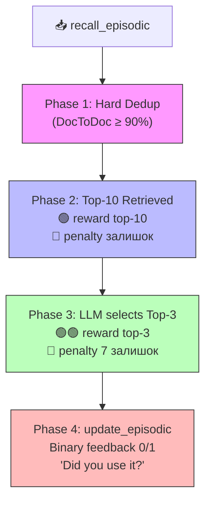
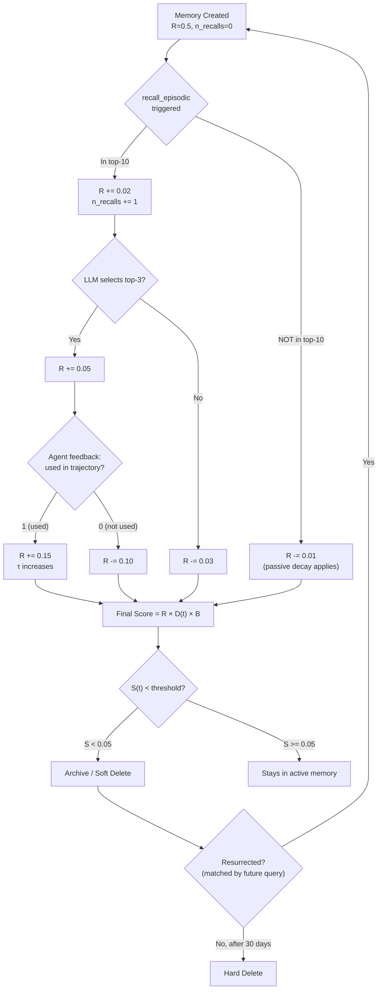

# Система оцінювання для Episodic Memory

## Чому чиста Ebbinghaus Forgetting Curve — не найкращий вибір

Класична крива Ebbinghaus моделює **пасивне забування** з часом:

$$R = e^{-\frac{t}{S}}$$

де $R$ — retention, $t$ — час, $S$ — stability (сила пам'яті).

**Проблема:** у вашій схемі вже є активні сигнали — reward/penalty від recall, LLM-selection, та binary feedback (0/1 "Did you use it?"). Чисте часове затухання **ігнорує** ці сигнали і може "забути" рідкісний, але критично важливий спогад.

---

## Рекомендація: Гібридна система SM-2 + Bayesian Decay

Я пропоную адаптацію **SuperMemo SM-2** (яка вже базується на Ebbinghaus, але додає active recall feedback) з байєсівським компонентом:

### Формула Score

$$\text{score}(m) = \underbrace{\alpha \cdot Q(m)}_{\text{quality signal}} \cdot \underbrace{e^{-\frac{t}{\tau(m)}}}_{\text{adaptive decay}} + \underbrace{\beta \cdot \text{freq}(m)}_{\text{retrieval bonus}}$$

де:
- $Q(m)$ — акумульована якість спогаду (від ваших reward/penalty)
- $\tau(m)$ — **адаптивний** період напіврозпаду (зростає при кожному successful recall)
- $\text{freq}(m)$ — нормалізована частота успішних retrieval
- $\alpha, \beta$ — ваги (настроюються)

---

## Конкретна реалізація під вашу схему

### 1. Поля кожного memory-об'єкта

```json
{
  "memory_id": "uuid",
  "content": "...",
  "embedding": [0.1, 0.2, ...],
  
  "scoring": {
    "base_score": 1.0,
    "total_recalls": 0,
    "successful_recalls": 0,
    "failed_recalls": 0,
    "last_accessed_at": "2025-01-15T10:00:00Z",
    "created_at": "2025-01-15T10:00:00Z",
    "stability": 1.0,
    "easiness_factor": 2.5,
    "consecutive_successes": 0
  }
}
```

### 2. Три точки оцінювання (mapping на вашу діаграму)



### 3. Алгоритм Score Update

```python
import math
from datetime import datetime, timezone


class MemoryScorer:
    """
    Hybrid SM-2 + Adaptive Decay scoring system for episodic memory.
    
    Combines:
    - SM-2 easiness factor (active recall quality)
    - Ebbinghaus-inspired adaptive decay (time-based forgetting)
    - Multi-phase reward/penalty from retrieval pipeline
    """

    # ── Reward / Penalty magnitudes ──────────────────────────
    REWARD_TOP10        =  0.05   # Retrieved into top-10
    PENALTY_NOT_TOP10   = -0.01   # In store but not retrieved
    REWARD_LLM_TOP3     =  0.10   # LLM judged relevant
    PENALTY_LLM_REJECT  = -0.05   # In top-10 but LLM rejected
    REWARD_USED         =  0.20   # Agent confirmed usage (1)
    PENALTY_NOT_USED    = -0.15   # Agent confirmed NOT used (0)

    # ── Decay parameters ─────────────────────────────────────
    INITIAL_STABILITY   = 1.0     # days (initial half-life)
    STABILITY_GROWTH    = 1.5     # multiplier on successful recall
    STABILITY_SHRINK    = 0.8     # multiplier on failed recall
    MIN_STABILITY       = 0.5     # floor: never decay faster than this
    MAX_STABILITY       = 365.0   # ceiling: ~1 year

    # ── SM-2 Easiness Factor ─────────────────────────────────
    MIN_EF              = 1.3
    INITIAL_EF          = 2.5

    # ── Final score bounds ───────────────────────────────────
    MIN_SCORE           = 0.01    # never fully zero (allow resurrection)
    MAX_SCORE           = 10.0

    # ── Soft-delete threshold ────────────────────────────────
    SOFT_DELETE_THRESHOLD = 0.05

    # ═════════════════════════════════════════════════════════
    #  Phase 1 — Hard Deduplication Reward
    # ═════════════════════════════════════════════════════════
    def reward_dedup_survivor(self, memory: dict) -> dict:
        """
        When duplicates are merged (DocToDoc >= 90%),
        the surviving document gets a small reward 
        absorbing the 'evidence' of the deleted duplicate.
        """
        scoring = memory["scoring"]
        scoring["base_score"] = min(
            self.MAX_SCORE,
            scoring["base_score"] + self.REWARD_TOP10
        )
        # Inherit recall count from merged doc (capped)
        scoring["total_recalls"] += 1
        return memory

    # ═════════════════════════════════════════════════════════
    #  Phase 2 — Top-10 Retrieval
    # ═════════════════════════════════════════════════════════
    def phase_top10(
        self, 
        retrieved_ids: list[str], 
        all_candidate_ids: list[str],
        memory_store: dict[str, dict]
    ) -> None:
        """
        After hybrid search + MMR returns top-10:
        - reward each of the 10
        - small penalty for everyone else that was a candidate
        """
        retrieved_set = set(retrieved_ids)
        for mid in all_candidate_ids:
            mem = memory_store[mid]
            s = mem["scoring"]
            if mid in retrieved_set:
                s["base_score"] += self.REWARD_TOP10
                s["total_recalls"] += 1
            else:
                s["base_score"] += self.PENALTY_NOT_TOP10
            s["base_score"] = max(self.MIN_SCORE, s["base_score"])

    # ═════════════════════════════════════════════════════════
    #  Phase 3 — LLM selects Top-3 from Top-10
    # ═════════════════════════════════════════════════════════
    def phase_llm_top3(
        self,
        top3_ids: list[str],
        top10_ids: list[str],
        memory_store: dict[str, dict]
    ) -> None:
        """
        LLM picks 3 most relevant from the 10.
        - top-3 get rewarded
        - remaining 7 get penalized
        """
        top3_set = set(top3_ids)
        for mid in top10_ids:
            mem = memory_store[mid]
            s = mem["scoring"]
            if mid in top3_set:
                s["base_score"] += self.REWARD_LLM_TOP3
                s["successful_recalls"] += 1
                s["consecutive_successes"] += 1
                # SM-2: increase easiness factor
                self._update_ef(s, quality=4)  # "good" recall
                # Ebbinghaus: strengthen stability
                s["stability"] = min(
                    self.MAX_STABILITY,
                    s["stability"] * self.STABILITY_GROWTH
                    * (1 + 0.1 * (s["easiness_factor"] - self.MIN_EF))
                )
            else:
                s["base_score"] += self.PENALTY_LLM_REJECT
                s["failed_recalls"] += 1
                s["consecutive_successes"] = 0
                self._update_ef(s, quality=2)  # "hard" recall
                s["stability"] = max(
                    self.MIN_STABILITY,
                    s["stability"] * self.STABILITY_SHRINK
                )
            s["base_score"] = max(self.MIN_SCORE, s["base_score"])
            s["last_accessed_at"] = datetime.now(timezone.utc).isoformat()

    # ═════════════════════════════════════════════════════════
    #  Phase 4 — Agent Binary Feedback (0/1 per memory)
    # ═════════════════════════════════════════════════════════
    def phase_agent_feedback(
        self,
        feedback: dict[str, int],   # {memory_id: 0 or 1}
        memory_store: dict[str, dict]
    ) -> None:
        """
        After trajectory completes, agent reports:
          memory_id => 1 (used) or 0 (not used).
        This is the STRONGEST signal.
        """
        for mid, used in feedback.items():
            mem = memory_store[mid]
            s = mem["scoring"]
            if used == 1:
                s["base_score"] += self.REWARD_USED
                s["successful_recalls"] += 1
                s["consecutive_successes"] += 1
                self._update_ef(s, quality=5)  # "perfect" recall
                s["stability"] = min(
                    self.MAX_STABILITY,
                    s["stability"] * self.STABILITY_GROWTH * 1.3
                )
            else:
                s["base_score"] += self.PENALTY_NOT_USED
                s["failed_recalls"] += 1
                s["consecutive_successes"] = 0
                self._update_ef(s, quality=1)  # "bad" recall
                s["stability"] = max(
                    self.MIN_STABILITY,
                    s["stability"] * self.STABILITY_SHRINK * 0.7
                )
            s["base_score"] = min(
                self.MAX_SCORE, 
                max(self.MIN_SCORE, s["base_score"])
            )
            s["last_accessed_at"] = datetime.now(timezone.utc).isoformat()

    # ═════════════════════════════════════════════════════════
    #  Effective Score (used for ranking / pruning)
    # ═════════════════════════════════════════════════════════
    def effective_score(self, memory: dict) -> float:
        """
        Combines base_score with Ebbinghaus-style time decay.
        
        effective = base_score × e^(-Δt / stability)
        
        This means:
        - High stability (many successful recalls) → slow decay
        - Low stability (failures) → fast decay
        - Recent access → less decay
        """
        s = memory["scoring"]
        now = datetime.now(timezone.utc)
        last = datetime.fromisoformat(s["last_accessed_at"])
        delta_days = (now - last).total_seconds() / 86400.0

        decay = math.exp(-delta_days / max(s["stability"], self.MIN_STABILITY))
        
        # Frequency bonus: ratio of successful to total recalls
        if s["total_recalls"] > 0:
            freq_bonus = s["successful_recalls"] / s["total_recalls"]
        else:
            freq_bonus = 0.5  # neutral for new memories

        effective = s["base_score"] * decay + 0.1 * freq_bonus
        return max(self.MIN_SCORE, min(self.MAX_SCORE, effective))

    # ═════════════════════════════════════════════════════════
    #  Should this memory be soft-deleted?
    # ═════════════════════════════════════════════════════════
    def should_soft_delete(self, memory: dict) -> bool:
        return self.effective_score(memory) < self.SOFT_DELETE_THRESHOLD

    # ═════════════════════════════════════════════════════════
    #  SM-2 Easiness Factor Update
    # ═════════════════════════════════════════════════════════
    def _update_ef(self, scoring: dict, quality: int) -> None:
        """
        SM-2 easiness factor formula.
        quality: 0-5 scale
          5 = perfect, used with confidence
          4 = good, relevant
          3 = okay, partially relevant  
          2 = hard, retrieved but not selected
          1 = bad, selected but not used
          0 = complete failure
        """
        ef = scoring["easiness_factor"]
        ef = ef + (0.1 - (5 - quality) * (0.08 + (5 - quality) * 0.02))
        scoring["easiness_factor"] = max(self.MIN_EF, ef)
```

### 4. Як decay працює візуально

```
Score
 ▲
 │  ★ recall + used (reward)
 │  ╱╲
 │ ╱  ╲___★ recall + used again (stability grows → slower decay)
 │╱       ╲__________________________________________
 │                                                    ╲
 │  ○ recall but NOT used (penalty + faster decay)
 │  ╱╲
 │ ╱  ╲___
 │╱      ╲____
 │             ╲_____○ not recalled (passive decay)
 │                    ╲___
 │                        ╲___
 │─ ─ ─ ─ ─ ─ ─ ─ ─ ─ ─ ─ ─ ╲─ ─  SOFT_DELETE_THRESHOLD
 │                              ╲
 └──────────────────────────────────▶ Time (days)
```

### 5. Mapping фаз на вашу діаграму

```mermaid
sequenceDiagram
    title Scoring Events Overlay
    participant ReAct
    participant MC as Memory Controller
    participant VS as Vector Store
    participant SC as Scorer

    ReAct->>MC: recall_episodic(query)
    MC->>VS: Hybrid search
    VS-->>MC: candidates (N docs)
    
    MC->>SC: phase_top10(top10_ids, all_ids)
    Note right of SC: 🟢 +0.05 top-10<br/>🔴 -0.01 others
    
    MC->>SC: Hard Dedup
    Note right of SC: 🟢 +0.05 survivor<br/>🗑️ delete duplicate
    
    MC->>MC: LLM selects top-3
    MC->>SC: phase_llm_top3(top3, top10)
    Note right of SC# Система оцінювання для Episodic Memory

## Чому чистий Ebbinghaus не підійде

Крива Еббінгауза моделює **пасивне забування** — як людина забуває без повторення. Але у вашій схемі пам'ять **активно оцінюється** через recall → use → feedback цикл. Тому потрібна **гібридна система**, яка поєднує часовий розпад з reinforcement-сигналами.

---

## Пропонована система: **Adaptive Relevance Scoring (ARS)**

### Формула фінального скору

$$S(t) = \underbrace{R(t)}_{\text{Relevance Score}} \times \underbrace{D(t)}_{\text{Decay Factor}} \times \underbrace{B}_{\text{Boost Multiplier}}$$

---

### 1. Decay Factor — натхненний Ebbinghaus

$$D(t) = e^{-\frac{\Delta t}{\tau \cdot (1 + k \cdot n_{\text{recalls}})}}$$

| Параметр | Опис |
|---|---|
| $\Delta t$ | Час від створення/останнього доступу |
| $\tau$ | Базовий період напіврозпаду (наприклад, 7 днів) |
| $k$ | Коефіцієнт зміцнення при повторенні (наприклад, 0.5) |
| $n_{\text{recalls}}$ | Кількість разів, коли пам'ять була recalled |

**Ключова ідея:** кожен успішний recall **збільшує** $\tau$, сповільнюючи забування — як spaced repetition.

---

### 2. Relevance Score — reinforcement-based

```
R(t) = clamp(R_base + Σ rewards - Σ penalties, R_min, R_max)
```

#### Таблиця reward/penalty сигналів

```
┌─────────────────────────────────────────────────┬─────────┐
│ Подія                                           │ Δ Score │
├─────────────────────────────────────────────────┼─────────┤
│ Потрапила в top-10 (retrieved)                  │ +0.02   │
│ LLM обрав у top-3                               │ +0.05   │
│ Agent підтвердив "used in trajectory" (1)       │ +0.15   │
│ Agent відхилив "not used" (0)                   │ -0.10   │
│ Потрапила в top-10, але НЕ в top-3              │ -0.03   │
│ НЕ потрапила в top-10 (не retrieved)            │ -0.01   │
│ Hard Dedup: merged (була дублікатом)            │ +0.05*  │
│ Використана у successful tool chain             │ +0.10   │
│ Пов'язана з negative outcome (what_to_avoid)    │ +0.03** │
└─────────────────────────────────────────────────┴─────────┘

*  Reward йде до top_doc, що "поглинув" дублікат
** what_to_avoid теж цінні — вони запобігають помилкам
```

#### Boundaries

```python
R_min = 0.05   # Ніколи не обнуляємо — є шанс на resurrect
R_max = 1.0
R_base = 0.5   # Стартовий скор нової пам'яті
```

---

### 3. Boost Multiplier — контекстуальні бонуси

$$B = \prod_{i} b_i$$

```
┌────────────────────────────────────────┬───────────┐
│ Умова                                  │ b_i       │
├────────────────────────────────────────┼───────────┤
│ Recency < 1 год                       │ 1.3       │
│ Є частиною "what_worked" ланцюжка     │ 1.2       │
│ Має cross-references до інших пам'яті │ 1.1       │
│ Створена самим агентом (не user)       │ 1.05      │
│ Flagged як "what_to_avoid"            │ 1.1       │
└────────────────────────────────────────┴───────────┘
```

---

## Повний lifecycle в вашій схемі



---

## Як це вписується у вашу sequence diagram

```
┌──────────────────────┬──────────────────────────────────────────────┐
│ Етап у діаграмі      │ Що відбувається зі скорами                  │
├──────────────────────┼──────────────────────────────────────────────┤
│ recall_episodic      │ 5W1H генерується → hybrid search →          │
│                      │ top-10 отримують +0.02                       │
│                      │ решта кандидатів отримують -0.01             │
├──────────────────────┼──────────────────────────────────────────────┤
│ Hard Deduplication   │ Дублікати видаляються,                       │
│                      │ top_doc отримує +0.05 за merge               │
├──────────────────────┼──────────────────────────────────────────────┤
│ MMR + LLM top-3      │ top-3: +0.05                                 │
│                      │ remaining 7: -0.03                           │
├──────────────────────┼──────────────────────────────────────────────┤
│ update_episodic      │ "Was it valuable?" →                         │
│ (agent feedback)     │ 1: +0.15 + τ boost                          │
│                      │ 0: -0.10                                     │
├──────────────────────┼──────────────────────────────────────────────┤
│ Background cron      │ D(t) перераховується кожні N годин           │
│ (не в діаграмі)      │ Архівація при S(t) < threshold              │
└──────────────────────┴──────────────────────────────────────────────┘
```

---

## Імплементація payload

```json
{
  "memory_id": "mem_abc123",
  "content": "Using pytest fixtures with conftest.py...",
  "embedding": [0.012, -0.034, ...],
  "scoring": {
    "relevance_score": 0.72,
    "n_recalls": 5,
    "n_used": 3,
    "n_rejected": 2,
    "last_accessed": "2025-01-15T10:30:00Z",
    "created_at": "2025-01-01T08:00:00Z",
    "tau_current": 10.5,
    "boost_flags": ["what_worked", "has_cross_refs"],
    "final_score": 0.68
  },
  "metadata": {
    "type": "what_worked",
    "tags": ["pytest", "testing"],
    "source_session": "session_xyz"
  }
}
```

---

## Чому саме так, а не чистий Ebbinghaus

| Аспект | Чистий Ebbinghaus | ARS (пропонована) |
|---|---|---|
| Враховує час | ✅ | ✅ |
| Враховує повторення | ✅ | ✅ |
| Враховує якість recall | ❌ | ✅ (LLM feedback) |
| Враховує реальне використання | ❌ | ✅ (agent trajectory) |
| Адаптується до контексту | ❌ | ✅ (boost multipliers) |
| Дозволяє resurrection | ❌ | ✅ (soft delete → archive) |
| Працює з deduplication | ❌ | ✅ (merge rewards) |

**Ebbinghaus — це фундамент** (decay factor), але ваша система потребує **active reinforcement learning loop**, бо агент **явно говорить**, чи була пам'ять корисною. Було б злочином це ігнорувати.