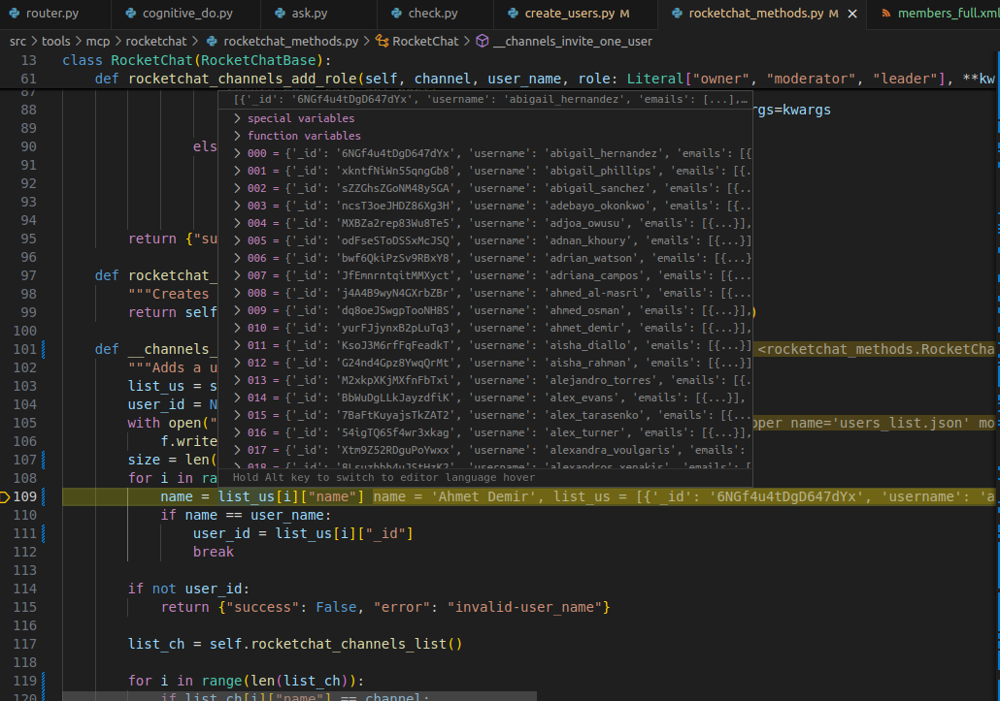

# RocketChat Documentation – Insights and Notes

Below are some observations and suggestions based on my testing and review of the RocketChat methods.

## 4. Optimization Idea
It might be better to define and return the `StructuredTool` objects directly in `rocketchat_methods.py` instead of generating them dynamically via code.

---

## 5. Large and Complex JSON Responses
- Methods often return **very large** JSON objects containing unnecessary data. Also, JSON maybe is not the best format for LLMs to analyze 
- Large JSONs are not very understandable, and many key names are not intuitive.
  - Example: The `chat_list_messages` method returns a key `"t"`(means type of message) whose values can be:
    - `"au"` → add user
    - `"ru"` → remove user
  - These abbreviations should be explained or rewritten at least. So it needs to filter or simplify responses before returning them to the LLM.

Should Docstrings provide an example of how to use tool?
---

## 6. Exception Handling
There may still be exceptions. These should be rewritten so that errors are returned in a format understandable by the LLM. And it could be 

---

## 7. More Tools Needed?
At the moment we have 14 tools. This tools must be enough to do tasks in TAC for Do node. However, it can be not enough for Check node. 
Example: Do node made a mistake and made wrong user a moderator in chat/channel. Check node noticed this mistake, but Check or Do node can't remove moderator because there is no tool for that.

## 8. Optimization Idea #2


Optimization idea -- ids are given to user in alphabetical order -- Look the picture below (at least for the users/members)
Binarysearch on alphabetical order. Can be very beneficial where a lot of users, channels, members in channels.

## 9. Python Module To Propose To Agent Most Appropriate Answer 
Idea From Volodymyr 22.09.2025 -- There is no Vasya Pupkin but Vasyliy Pupkin. Having this function our agent can resolve issue finding right person

## Testing
I tested the RocketChat MCP using the `test.py` script:  
```bash
# Run from the `src` directory
python test.py
```

## Danylo's Testing 